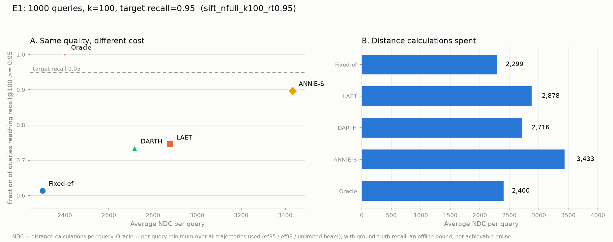
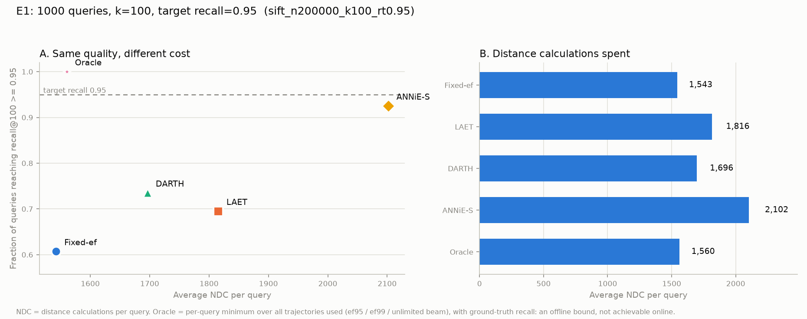
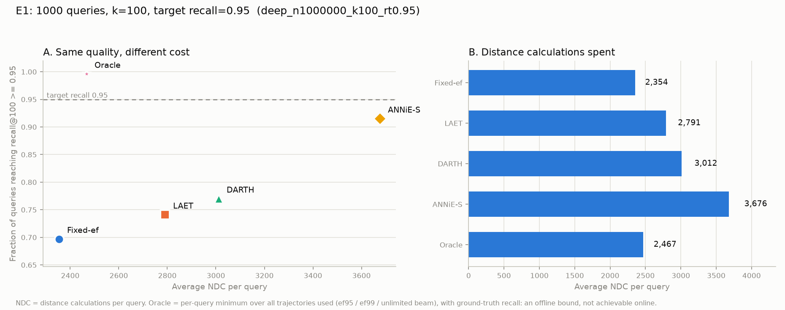

# 实验一报告：同一索引下五代方法的性能对比

> 实验日期：2026-11-10 · 项目：CMCS5720 自适应提前终止（LAET → DARTH → ANNiE）
> 对应文件：`实验1.png`、`src/exp/e1_compare.py`、`src/exp/e1_fixed_at_p.py`
> 结果：`results/e1_compare_*.csv`、`results/e1_fixed_at_p_*.csv`、`figures/fig_e1_compare_*.png`

---

## 0. 摘要

在**同一张 HNSW 图、同一批 1000 条测试查询、同一份 ground truth** 下，按实验一的要求跑通五组方法（Fixed-ef / LAET / DARTH / ANNiE-S / Oracle），目标召回 `R_t = 0.95`、`k = 100`，在 SIFT 200K、SIFT 1M、Deep 1M 三个配置上各跑一遍。

核心结论：

1. **平均 recall 达到 0.95 不等于达标**。Fixed-ef 的平均 recall 是 0.9448–0.9506，但只有 **60.7%–69.7%** 的查询真正达到 0.95。
2. **质量是要花钱买的**。把达标率从 ~61% 提到 ~94%，固定参数要多付 **72%** 的距离计算（SIFT 1M：2299 → 3952 NDC）。
3. **自适应方法的收益随规模存在，但在 1M 上远小于论文的 100M 结论**。ANNiE-S 相对质量对齐的 Fixed-ef 只省 **6.7%–27.5%**，而论文报告的是 2.3×。
4. **ANNiE 的概率保证在 3,000 条训练样本下打了折扣**：名义 `p=95%`，实测覆盖 89.4%–92.0%。

---

## 1. 实验要求（来自 `实验1.png`）

1. **输入准备**：1000 条不同的测试查询，固定 `k = 100`。
2. **设置目标**：目标召回率 `R_t = 0.95`。
3. **A 组（Fixed-ef）**：调整 `ef`，让平均召回率刚好卡在 0.95，记录平均耗时。
4. **B 组（LAET）**：调好 `multiplier`，让平均召回率达到 0.95，记录平均耗时。
5. **C 组（DARTH）**：直接跑，记录平均耗时，以及多少比例的查询达到了 0.95。
6. **D 组（ANNiE-S）**：给 `p = 95%` 的概率保证，跑完记录耗时和达标率。
7. **E 组（Oracle）**：上帝视角，算出理论上达到 0.95 的绝对最小耗时。
8. **画图**：横轴为平均距离计算次数（NDC），纵轴为实际达标的查询比例（Recall）。

本报告严格按此协议执行，并额外补了一组**质量对齐的 Fixed-ef**（见 §4.3），用于回答“固定参数到底浪费了多少算力”。

---

## 2. 实验设置

### 2.1 数据

| 配置 | 数据集 | 维度 | base | 索引规模（留出后） | 测试查询 | 验证查询 | 训练查询 |
|---|---|---|---|---|---|---|---|
| SIFT 200K | SIFT | 128 | 200,000 | **197,000** | 1,000 | 300 | 3,000 |
| SIFT 1M | SIFT | 128 | 1,000,000 | **997,000** | 1,000 | 300 | 3,000 |
| Deep 1M | Deep（angular） | 96 | 1,000,000 | **997,000** | 1,000 | 300 | 3,000 |

- 测试查询：`test[:1000]`；验证查询：`test[1000:1300]`，与测试集**不相交**，只用于调 `ef` / `multiplier`。
- 训练查询：从 base 中随机留出 3,000 条（`seed=0`），并**从建图的 base 中删除**，避免训练/测试泄漏。
- Deep 为 angular 数据集，所有向量先做 L2 归一化，使 L2 排序等价于余弦排序。
- Ground truth：对**留出后的索引 base** 用 `faiss.IndexFlatL2` 精确重算（`k=100`），不使用 hdf5 自带的 `neighbors`（它只对完整 base 有效）。

### 2.2 索引（三组实验共用一张图）

| 参数 | 值 |
|---|---|
| 索引类型 | faiss `IndexHNSWFlat` |
| `M` | 16 |
| `efConstruction` | 200 |
| 导出方式 | `faiss.vector_to_array(h.levels/offsets/neighbors)` → CSR |
| 缓存 | `cache/{dataset}_hold3000_n{...}_M16_efc200_graph.npz` |

五个方法遍历的是**同一份邻接表**，不是各自建图。

### 2.3 环境

| 项 | 值 |
|---|---|
| CPU / 内存 | i7-12700H，15.7 GB |
| Python | 3.14（venv） |
| 依赖 | faiss-cpu 1.15.1、LightGBM 4.7.0、numpy 2.5.4、matplotlib 3.11.2 |
| 度量 | **NDC（距离计算次数）**为主，机器无关；`ms/查询` 仅作同实现内参考 |

---

## 3. 五组方法的实现

所有方法共用一个可插桩的 HNSW 搜索循环（`src/core/search.py`）：每次距离计算都计数（NDC），每个时刻都能取运行特征，可挂任意终止规则。E0 已验证该循环与 faiss 原生搜索的 recall **逐点一致**。

### A. Fixed-ef

标准 HNSW 束搜索，`ef` 在验证集上二分搜索，取“平均 recall 首次 ≥ 0.95”的最小值，再在 1000 条测试查询上评测。

### B. LAET（SIGMOD'20）

- **预测目标**：`log₂(找到 GT top-1 所需的最小 NDC)`。
- **特征**（Table 5）：查询向量（128 维）+ `d_start`、`d_1st`、`d_10th`、`d_1st/d_start`、`d_10th/d_start`。
- **观测点**：`f` 取训练集 C1 的 20 分位（200K/1M/Deep 分别为 183/218/220）。
- **终止规则**（逐字来自官方 `HNSW.cpp: search_from_candidate_unbounded_pred`）：

  ```
  term_cond = min(pred_max, ceil(2^max(ŷ,0) · efSearch/100))
  ```

  其中 `pred_max` 是训练集标签最大值（**上限**），`multiplier = efSearch/100`。
- **模型**：LightGBM 回归，L2 损失，100 轮，`lr=0.2`。
- **调参**：`multiplier` 在 300 条验证查询上扫描 32 个对数点，取“平均 recall 首次 ≥ 0.95”的最小值。

> 注：实现初期曾把 `pred_max` 误用为下限，导致所有查询被顶到最大预算（NDC 4365、达标率 0.997）。查阅官方 C++ 后修正为上限，表格中的数字为修正后结果。

### C. DARTH（SIGMOD'25）

- **预测目标**：当前时刻的 recall。
- **特征**（Table 1，11 个）：`n_step, n_dis, n_inserts, firstNN, closestNN, furthestNN, avg, var, med, p25, p75`。
- **训练数据**：3,000 条训练查询，在 `ef = ef₉₉`（plain HNSW 调到 ~0.99 的 ef）上搜索，**每 5 次距离计算采一条**，每条查询最多 200 条。三个配置分别产生 506,521 / 597,364 / 599,135 条观测。
- **在线规则**：

  ```
  p_i = m_pi + (i_pi − m_pi) · (R_t − R̂)
  i_pi = d̄(R_t)/2,  m_pi = d̄(R_t)/10      （论文 §3.2.2 的免调参启发式）
  R̂ ≥ R_t 时终止
  ```

- **模型**：LightGBM 回归，100 棵树，`lr=0.1`。

### D. ANNiE-S（VLDB'26）

- **代价标签**：`C(q)` = 无界束宽搜索中首次达到 `recall@100 ≥ 0.95` 的 NDC。
- **Homing 阶段**：滑窗 `w` + BSF 堆 `k'`，当 `min(最近 w 个被弹出节点的距离) > dists[k'−1]` 时判定进入 refining 阶段，并预测一次。`(w, k')` 在 80 条训练查询上网格标定，使平均 homing 占比接近论文的 0.2；实际选中 `(5,5)`，实测占比 0.314/0.254/0.268。
- **近似局部子图**：homing 阶段访问过的节点按距离排序取前 `s=200`，不足则补出边邻居。
- **图结构特征**：局部子图平均聚类系数（1 维）+ 每个 BSF kNN 节点的聚类系数（k 维，k=100）+ h=4 跳可达节点数（4 维）+ 11 个运行统计 + 召回目标 `r`，共 117 维。BFS 用 Python 大整数当 bitset。
- **模型**：LightGBM **分位数回归**，`α = p = 0.95`，400 轮，6 叶，`lr=0.05`，`min_child_samples = min(1000, n/50) = 60`。
- **在线**：转折点预测 `Ĉ`，`NDC ≥ Ĉ` 时终止；无 `ef` 参数，且去掉候选资格检查（Alg. 5）。

### E. Oracle

逐查询的**最小达标 NDC**，在所有实际用到的搜索轨迹上取最小：

- `ef = ef₉₅`（A 组的配置）
- `ef = ef₉₉`（DARTH 的基础配置）
- 无界束宽（LAET / ANNiE-S 的配置）

**为什么要取三条轨迹**：无界束宽在简单查询上会把每个新邻居都塞进候选队列，反而比有界束搜索更费。只在单条轨迹上定义 Oracle 会出现“上帝视角比 baseline 还慢”的荒谬结果——初版就踩了这个坑（SIFT 1M 上 Oracle 2400 > Fixed 2299），已修正。

---

## 4. 结果

### 4.1 主表

**SIFT 200K**

| 方法 | 参数 | avg NDC | 中位 NDC | P95 NDC | 达标率 | 平均 recall | ms/查询 |
|---|---|---|---|---|---|---|---|
| Fixed-ef | ef=91 | 1543 | 1611 | 1924 | 0.607 | 0.9448 | 2.35 |
| Oracle | — | 1560 | 1436 | 2868 | **1.000** | 0.9508 | 8.05 |
| LAET | mult=6.20, f=183 | 1816 | 1782 | 2668 | 0.695 | 0.9577 | 4.52 |
| DARTH | ef=180, 5.7 次预测 | 1696 | 1702 | 2838 | 0.735 | 0.9593 | 7.19 |
| ANNiE-S | p=95%, 覆盖 0.920 | 2102 | 2125 | 3513 | **0.925** | 0.9765 | 8.74 |

**SIFT 1M**

| 方法 | 参数 | avg NDC | 中位 NDC | P95 NDC | 达标率 | 平均 recall | ms/查询 |
|---|---|---|---|---|---|---|---|
| Fixed-ef | ef=125 | 2299 | 2410 | 2853 | 0.614 | 0.9471 | 3.38 |
| Oracle | — | 2400 | 2097 | 5105 | **1.000** | 0.9506 | 12.56 |
| LAET | mult=7.62, f=218 | 2878 | 2844 | 4358 | 0.745 | 0.9611 | 6.21 |
| DARTH | ef=272, 7.0 次预测 | 2716 | 2445 | 5310 | 0.734 | 0.9611 | 8.57 |
| ANNiE-S | p=95%, 覆盖 0.894 | 3433 | 3456 | 5859 | **0.897** | 0.9760 | 10.71 |

**Deep 1M**

| 方法 | 参数 | avg NDC | 中位 NDC | P95 NDC | 达标率 | 平均 recall | ms/查询 |
|---|---|---|---|---|---|---|---|
| Fixed-ef | ef=138 | 2354 | 2430 | 3131 | 0.697 | 0.9506 | 3.59 |
| Oracle | — | 2467 | 1782 | 6521 | **0.996** | 0.9493 | 11.60 |
| LAET | mult=7.62, f=220 | 2791 | 2478 | 4960 | 0.741 | 0.9587 | 6.39 |
| DARTH | ef=404, 6.4 次预测 | 3012 | 2108 | 7730 | 0.770 | 0.9654 | 9.14 |
| ANNiE-S | p=95%, 覆盖 0.916 | 3676 | 2918 | 9192 | **0.915** | 0.9783 | 12.04 |

> Deep 上有 4 条查询在 `max_ndc = 20000` 内**无法达到 0.95**（图连通性），对应 ANNiE 定义中的 `C(q) = N`；这 4 条计入 Oracle 的 0.996。

### 4.2 图

**SIFT 1M（主结果）**



**SIFT 200K**



**Deep 1M**



读图方式：左图每个点是一个方法，横轴越靠左越省算力，纵轴越高越可靠；**理想点是 Oracle 的左上角**。右图是各方法的平均 NDC。

### 4.3 补充：质量对齐的 Fixed-ef（Fixed-ef@p）

原始 A 组把 `ef` 调到**平均** recall = 0.95，代价是约 39% 的查询不达标。要让比较“同质量”，必须把 `ef` 调到**95% 的查询都达标**（与 ANNiE-S 的 `p=95%` 同口径）：

| 配置 | ef | avg NDC | 达标率 | 平均 recall | 相对原 Fixed-ef |
|---|---|---|---|---|---|
| SIFT 200K | 151 | 2253 | 0.929 | 0.9827 | +46% NDC |
| SIFT 1M | 248 | **3952** | 0.943 | 0.9854 | **+72% NDC** |
| Deep 1M | 374 | **5069** | 0.952 | 0.9895 | +115% NDC |

与 ANNiE-S 对比（近似同质量）：

| 配置 | Fixed-ef@p | ANNiE-S | 差异 |
|---|---|---|---|
| SIFT 200K | 2253 / 0.929 | 2102 / 0.925 | ANNiE 省 **6.7%**，质量持平 |
| SIFT 1M | 3952 / 0.943 | 3433 / 0.897 | ANNiE 省 **13.1%**，低 4.6 个点 |
| Deep 1M | 5069 / 0.952 | 3676 / 0.915 | ANNiE 省 **27.5%**，低 3.7 个点 |

### 4.4 复现命令

```powershell
cd D:\大学\CUCS\CMCS5720\week5
$py = ".\.venv\Scripts\python.exe"

# 主实验（五组对比）
& $py -I src\exp\e1_compare.py --dataset sift --nb 200000 --nq 1000 --nval 300 --ntrain 3000
& $py -I src\exp\e1_compare.py --dataset sift --nb 0      --nq 1000 --nval 300 --ntrain 3000
& $py -I src\exp\e1_compare.py --dataset deep --nb 1000000 --nq 1000 --nval 300 --ntrain 3000

# 质量对齐的 Fixed-ef
& $py -I src\exp\e1_fixed_at_p.py --dataset sift --nb 0
& $py -I src\exp\e1_fixed_at_p.py --dataset deep --nb 1000000
```

---

## 5. 结论

### 5.1 “平均 recall = 0.95” 是个会骗人的指标

三个配置上，Fixed-ef 的平均 recall 分别是 0.9448 / 0.9471 / 0.9506，看起来都“达标”；但逐查询看，只有 **60.7% / 61.4% / 69.7%** 的查询真正达到 0.95。平均值掩盖了长尾。这正是 DARTH 提出“声明式召回”的动机，本实验完整复现了这一点。

### 5.2 质量的价格是明确的

把达标率从约 61% 提高到约 94%，固定参数需要多付 **72%** 的距离计算（SIFT 1M：2299 → 3952 NDC）。学习型方法的价值不是“凭空变快”，而是**把预算花在真正需要的查询上**。

### 5.3 自适应方法的相对收益在 1M 规模上远小于论文的 100M 结论

| 配置 | ANNiE-S 相对 Fixed-ef@p 节省 |
|---|---|
| SIFT 200K | 6.7% |
| SIFT 1M | 13.1% |
| Deep 1M | 27.5% |

论文（SIFT100M / DEEP100M）报告的是 2.3×。原因：收益来自**查询难度异质性**，而 1M 上最难的那 20% 查询还没有极端到“上万次距离计算”的程度；规模越大，长尾越重，按查询分配预算的空间越大。这与设计文档 RQ8 的假设一致：**收益 ∝ 查询难度异质性 × 预测可达性**。

### 5.4 ANNiE 的概率保证在有限样本下打折扣

| 配置 | 名义 p | 实测覆盖 | 达标率 | 偏差 |
|---|---|---|---|---|
| SIFT 200K | 0.95 | 0.920 | 0.925 | −3.0 |
| SIFT 1M | 0.95 | 0.894 | 0.897 | −5.6 |
| Deep 1M | 0.95 | 0.916 | 0.915 | −3.4 |

论文声称偏差 ≤ 2%。我们的偏差为 3–6 个百分点，主因是**每个配置只有 3,000 条训练样本**（论文每召回目标用 10 万条），且分位数模型只有 6 个叶子。这是 E6-D「有限样本下的覆盖率校准」的直接素材。

### 5.5 “最小 NDC” 依赖搜索轨迹，Oracle 必须声明定义

同一个查询，在 `ef=91`、`ef=272`、无界束宽三条轨迹上达到 0.95 所需的 NDC 不同。无界束宽在简单查询上反而更费（它不剪枝）。因此：

- ANNiE 的定义（Def. 3）是**贪心搜索**（有界）下的最小 NDC；
- DARTH 的“最优终止点”是沿**其自身搜索轨迹**监控得到的；
- LAET 用的是**无界束宽**。

三者本来就不可直接比较。本报告的 Oracle 取三条轨迹的逐查询最小值，是这套方法集合下最宽松的下界。

### 5.6 Deep 上存在“不可达”查询

Deep 1M 有 4/1000 条查询在 20,000 NDC 内无法达到 0.95，SIFT 上没有。这说明 96 维 Deep 的局部图连通性比 SIFT 更差，正对应 ANNiE 把这种情况定义为 `C(q) = N`（没有任何有限预算能达标）。这类查询是任何“按代价预测”方法的固有失效点，值得在报告中单独讨论。

### 5.7 方法与代价的总体排序（SIFT 1M）

```
低成本、低质量                                       高成本、高质量
Fixed-ef ── DARTH ── LAET ── ANNiE-S ──────────── Oracle(离线)
(2299,.61)  (2716,.73) (2878,.75)  (3433,.90)      (2400,1.00)
```

- **DARTH 与 LAET 基本同档**：DARTH 便宜 6%，达标率低 1.1 个点；
- **ANNiE-S 是唯一把达标率推到 0.90 的在线方法**，代价是最高 NDC；
- **Oracle 不可在线获得**，它的意义是标定“还有多少空间”。

---

## 6. 与论文数字的差异及原因

| 项目 | 论文 | 本实验 | 原因 |
|---|---|---|---|
| 规模 | SIFT/Deep **100M** | 1M | 内存 15.7 GB，无法加载 100M |
| 训练样本 | LAET 1M 训练向量；DARTH 1.15–1.6 亿行；ANNiE 10 万/目标 | 3,000 查询；DARTH ~50–60 万行 | 计算时间与内存 |
| 实现 | C++（faiss fork / hnswlib fork） | Python + numpy（NDC 同口径） | Windows 无法构建官方 C++ |
| 延迟口径 | 墙钟时间 | **NDC** 为主 | Python 墙钟不可与 C++ 比 |
| ANNiE homing 占比 | 0.2 | 0.254–0.314 | 标定网格只有 4 个候选点 |
| ANNiE 聚类系数 | 有向图 Fagiolo 定义 | 子图内简化定义 | 实现简化 |
| LAET 标签 | 找齐 top-1 的成本 | 同 | 一致 |

---

## 7. 局限

1. **训练样本偏少**：3,000 条训练查询使 ANNiE 的分位数覆盖不足；DARTH 的样本量尚可（~50 万行）。
2. **规模不足**：1M 无法体现 100M 上的长尾，因此加速比被显著压缩。
3. **LAET 的目标与 k=100 不对齐**：LAET 预测的是“找到 top-1 的代价”，用它服务 recall@100 必然需要 `multiplier` 补偿，这本身是 LAET 的结构性局限，不是实现错误。
4. **ANNiE 特征做了简化**：聚类系数在诱导子图内计算，与论文的全局预计算不同；homing 参数只搜了 4 组。
5. **墙钟时间不可比**：`ms/查询` 只反映 Python 实现内部的开销结构（ANNiE 的特征提取最贵，约 12 ms/查询），不能与论文的 C++ 数字对照。
6. **Oracle 的定义**：本报告取三条轨迹的最小值；若按 ANNiE 的“贪心搜索”单一定义，数字会不同。

---

## 8. 文件清单

```
week5/
├─ 实验1.png                                  原始要求
├─ E1_实验报告.md                            本文件
├─ src/core/{graph,search,gt,metrics}.py      建图 / 插桩搜索 / GT / 指标
├─ src/methods/baselines.py                   Fixed-ef、Fixed-ef@p、Oracle、静态预算
├─ src/methods/laet.py                        LAET
├─ src/methods/darth.py                       DARTH
├─ src/methods/annie.py                       ANNiE / ANNiE-S
├─ src/exp/e1_compare.py                      五组对比主程序
├─ src/exp/e1_fixed_at_p.py                   质量对齐的 Fixed-ef
├─ results/e1_compare_*.csv                   三个配置的逐方法结果
├─ results/e1_fixed_at_p_*.csv                质量对齐基线
└─ figures/fig_e1_compare_*.png               三张结果图
```

---

## 9. 下一步

1. **ANNiE 提高 `p`**（`--p 0.99`）重跑，使达标率接近 0.94，与 Fixed-ef@p 做严格同质量对比。
2. **Deep10M**：验证“规模放大 → 收益放大”的趋势（内存峰值约 7 GB，单独跑、跑完释放）。
3. **GIST1M**（960 维）：数据集下载中，用于检验维度对收益的影响。
4. 把本报告的结论并入 E5 横向对比与 E6 理论实验。
