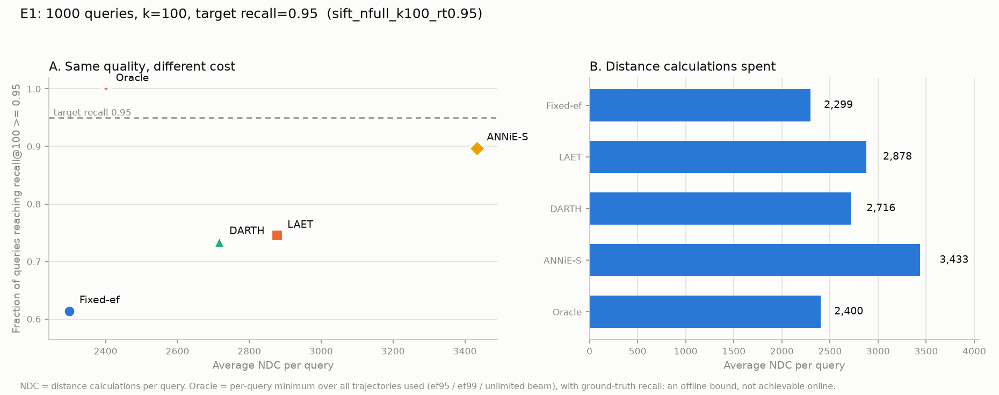

# CMCS5720 — ANN 自适应提前终止（LAET → DARTH → ANNiE）

在同一张 HNSW 图上复现并对比三代"学习型提前终止"方法，对应**实验一**：

> 1000 条测试查询、`k=100`、目标召回 `R_t=0.95`，比较 Fixed-ef / LAET / DARTH / ANNiE-S / Oracle 的平均距离计算次数（NDC）与逐查询达标率。

完整说明与结论见 **[E1_实验报告.md](E1_实验报告.md)**。

---

## 结果速览（SIFT 1M）

| 方法 | avg NDC | 达标率 | 平均 recall |
|---|---|---|---|
| Fixed-ef (ef=125) | 2,299 | 0.614 | 0.9471 |
| DARTH | 2,716 | 0.734 | 0.9611 |
| LAET | 2,878 | 0.745 | 0.9611 |
| ANNiE-S (p=95%) | 3,433 | 0.897 | 0.9760 |
| Oracle（离线） | 2,400 | 1.000 | 0.9506 |
| **Fixed-ef@p（质量对齐）** | **3,952** | **0.943** | 0.9854 |



三条结论：

1. 平均 recall 0.95 ≠ 达标：Fixed-ef 只有 61% 的查询真正达到 0.95。
2. 把达标率提到 94%，固定参数要多付 **72%** 的 NDC。
3. 1M 规模下 ANNiE-S 相对质量对齐的 Fixed-ef 只省 7%–28%（论文的 2.3× 来自 100M 规模）。

---

## 目录结构

```
src/
  core/graph.py        用 faiss 建 HNSW，导出 CSR 邻接表并缓存
  core/search.py       可插桩搜索循环（NDC 计数、运行特征、任意停止规则）
  core/gt.py           数据集加载、精确 GT、训练查询留出
  core/metrics.py      recall / RQUT / RDE / NRS / MAPE / Q-error / pMAPE / 覆盖
  methods/baselines.py Fixed-ef、Fixed-ef@p、Oracle、静态预算
  methods/laet.py      LAET（SIGMOD'20）
  methods/darth.py     DARTH（SIGMOD'25）
  methods/annie.py     ANNiE / ANNiE-S（VLDB'26）
  exp/e1_compare.py    ★ 五组主实验
  exp/e1_fixed_at_p.py 质量对齐的 Fixed-ef 基线
  exp/e0_validate.py   保真性验证：自实现搜索 vs faiss
scripts/download_data.py
results/               每次运行的 CSV
figures/               每次运行的 PNG
```

---

## 快速开始

```powershell
# 1. Python 环境（3.10+，示例用 3.14）
python -m venv .venv
.\.venv\Scripts\Activate.ps1
pip install -r requirements.txt

# 2. 下载数据（约 4.4 GB：SIFT 525 MB + Deep 3.85 GB）
python scripts/download_data.py --datasets sift deep

# 3. 保真性验证（自实现搜索的 recall 必须与 faiss 逐点一致）
python src/exp/e0_validate.py 200000 sift

# 4. 主实验（2 万条冒烟 → 20 万 → 全量 1M）
python src/exp/e1_compare.py --dataset sift --nb 20000  --nq 100 --nval 50 --ntrain 300
python src/exp/e1_compare.py --dataset sift --nb 200000
python src/exp/e1_compare.py --dataset sift --nb 0        # 全量
python src/exp/e1_compare.py --dataset deep --nb 1000000

# 5. 质量对齐的 Fixed-ef（与 ANNiE-S 的 p=95% 同口径）
python src/exp/e1_fixed_at_p.py --dataset sift --nb 0
```

数据集默认放在 `./data`。若已在别处，设置环境变量：

```powershell
$env:ANNS_DATA = "D:\datasets\ann-benchmarks"
```

### 参数

| 参数 | 默认 | 说明 |
|---|---|---|
| `--dataset` | sift | `sift` / `glove` / `gist` / `fashion` / `deep` |
| `--nb` | 0 | base 大小，0 = 全部；Deep 建议 1000000 |
| `--nq` / `--nval` | 1000 / 300 | 测试查询 / 调参验证查询（互不相交） |
| `--ntrain` | 3000 | 从 base 留出的训练查询数（会从索引中删除） |
| `--k` / `--rt` | 100 / 0.95 | 返回邻居数 / 目标召回 |
| `--p` | 0.95 | ANNiE 的 RTG 概率（分位数损失的 τ） |
| `--m` / `--efc` | 16 / 200 | HNSW 的 M 与 efConstruction |
| `--max-ndc` | 40000 | 单查询 NDC 上限（防止病态查询） |

运行时间参考（i7-12700H，单进程）：SIFT 200K 约 3 分钟，SIFT 1M 约 7 分钟，Deep 1M 约 8 分钟（含建图与训练）。

---

## 数据说明（重要）

**原始数据集不在仓库里**，原因：`deep` 3.85 GB、`gist` 3.84 GB，超过 GitHub 单文件 100 MB 限制，也超出免费 Git LFS 配额。请用 `scripts/download_data.py` 获取，脚本支持断点续传。

| 数据集 | 维度 | 文件 |
|---|---|---|
| SIFT1M | 128 | `sift-128-euclidean.hdf5` |
| GloVe1M | 100 | `glove-100-angular.hdf5` |
| GIST1M | 960 | `gist-960-euclidean.hdf5` |
| Fashion-MNIST | 784 | `fashion-mnist-784-euclidean.hdf5` |
| Deep1M/10M | 96 | `deep-image-96-angular.hdf5` |

`cache/`（导出的图邻接表）同样不入库，首次运行会自动重建：SIFT 1M 约 65 秒。

---

## 方法实现与论文的对应

| 方法 | 预测目标 | 关键实现 |
|---|---|---|
| LAET | `log₂`(找到 GT top-1 的最小 NDC) | 预算 `min(pred_max, 2^ŷ·mult)`，来自官方 `HNSW.cpp` |
| DARTH | 当前 recall | 11 个运行特征；`p_i = m_pi + (i_pi−m_pi)(R_t−R̂)` |
| ANNiE-S | 达到 `r@k` 所需的最小 NDC | homing 转折点 + 局部子图（聚类系数、h 跳可达性）+ 分位数损失 |

Oracle 取 `ef₉₅ / ef₉₉ / 无界束宽` 三条轨迹的逐查询最小 NDC（见报告 §3.E）。

**已知偏差**（详见报告 §6–§7）：规模 1M（论文 100M）、训练样本 3,000（论文 10 万）、Python 实现（NDC 同口径，墙钟不可比）、ANNiE 的聚类系数为子图内简化定义。

---

## 参考

- Li et al., *Improving Approximate Nearest Neighbor Search through Learned Adaptive Early Termination*, SIGMOD 2020. <https://github.com/efficient/faiss-learned-termination>
- Chatzakis et al., *DARTH: Declarative Recall Through Early Termination*, SIGMOD 2025. <https://github.com/MChatzakis/DARTH>
- Wang et al., *ANNiE: A Learned Query Cost Estimator for Graph-Based ANNS*, VLDB 2026. <https://github.com/CaucherWang/ANNiE>

数据集来自 [ANN Benchmarks](https://ann-benchmarks.com/)。

> 本仓库为课程作业，第三方代码与数据集版权归各自作者所有。
