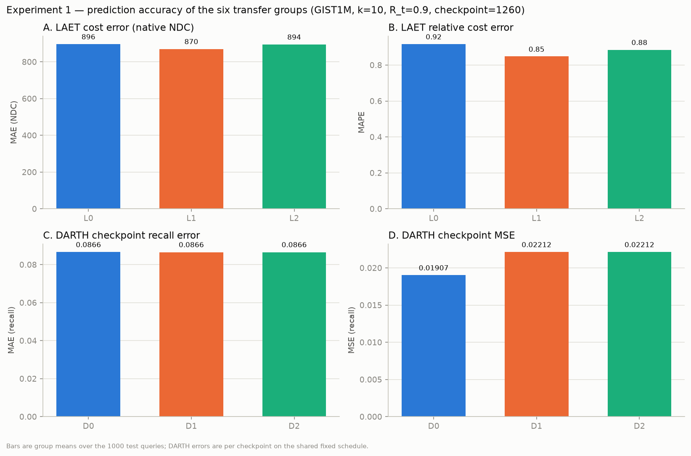
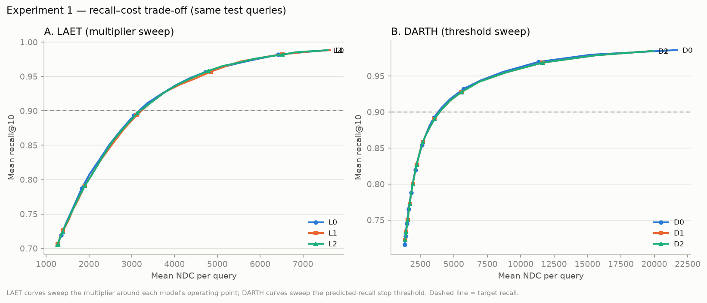
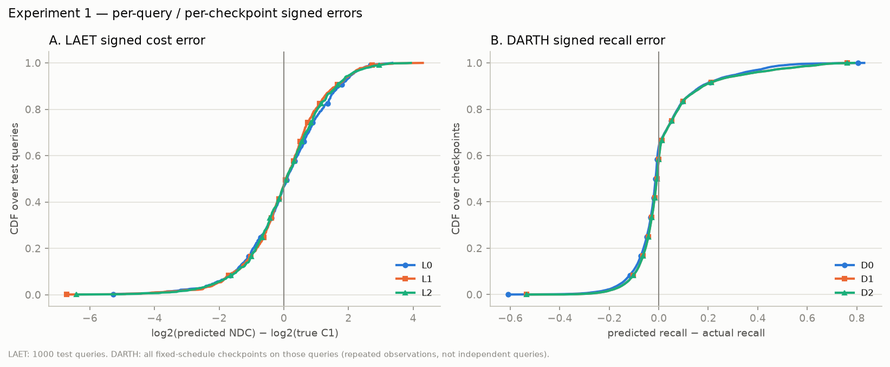
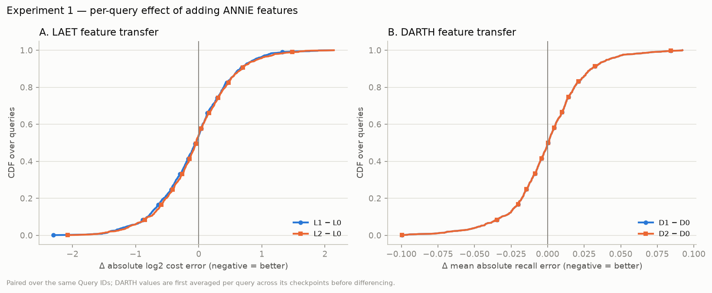
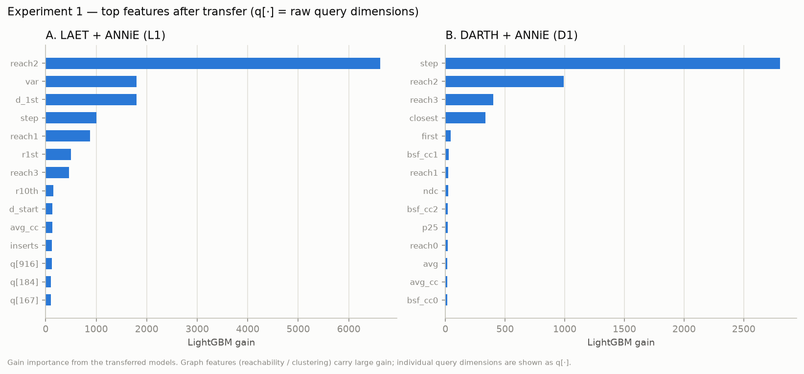
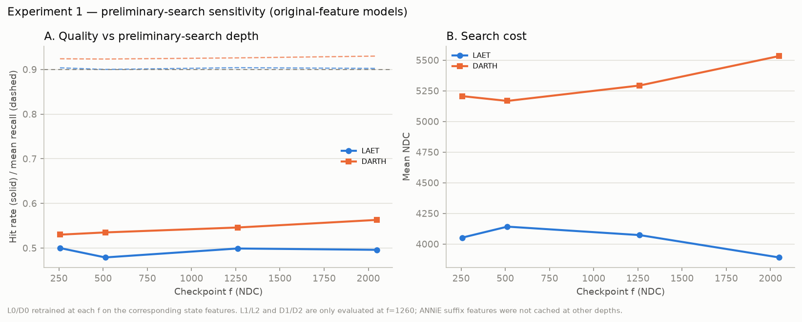
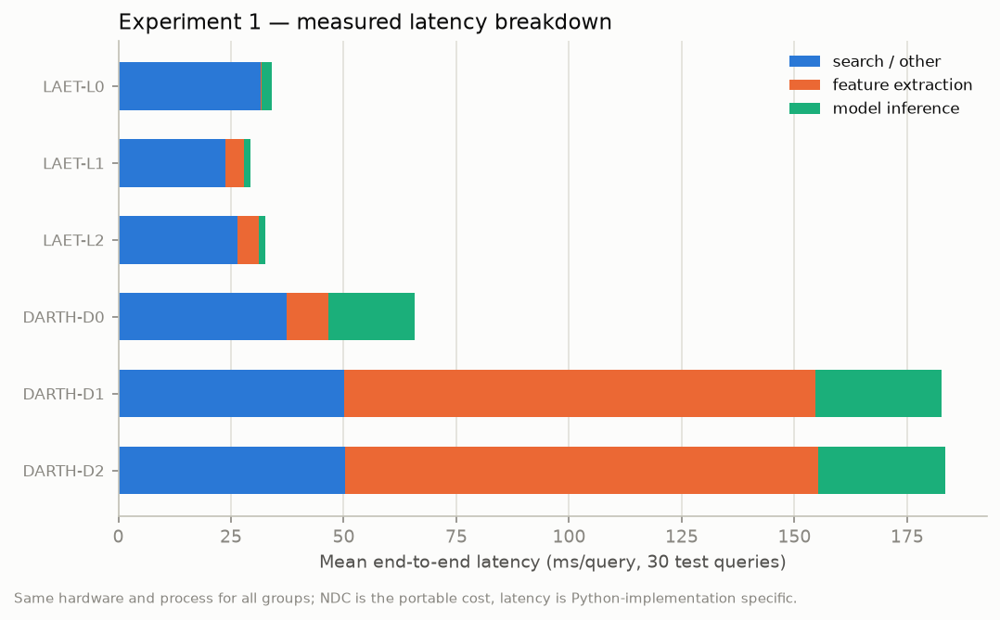
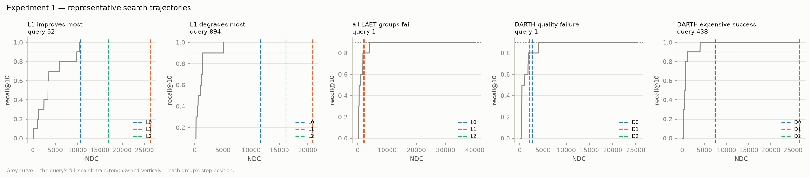

# Experiment 1 — Feature Transfer Ablation Study

## 1. Introduction

This experiment asks whether the input features used by ANNiE carry
information that LAET's and DARTH's original feature sets miss, while keeping
each method's prediction target, loss, checkpoint and stopping rule fixed.
Only the feature matrix changes across the six controlled groups.  The
dataset is GIST1M (992,000 index vectors, 960-d), k=10,
target recall 0.9, unified checkpoint f=1,260 NDC,
5,000 training / 500 validation / 1,000 official test queries (disjoint).

## 2. Research questions and hypotheses

RQ1: do ANNiE's features improve LAET/DARTH prediction accuracy?
RQ2: are the two feature sets complementary or substitutable?
RQ3: do prediction gains survive feature-extraction and inference cost?
RQ4: does the effect depend on preliminary-search depth?

The pre-registered hypotheses and decision rules are in
`research_questions.md`; they were fixed before the test run.

## 3. Methodology

* One hnswlib graph (M=16, efConstruction=200) parsed into the instrumented
  CSR search; NDC counts every base-layer squared-L2 evaluation.
* LAET: LightGBM L2 on `log2(C1)`, one prediction at NDC>=1,260, budget
  `max(f, min(2^pred * multiplier, pred_max))`; multiplier calibrated on the
  500 validation queries.
* DARTH: LightGBM L2 on current recall; Mode A uses the same 24-point fixed grid of
  checkpoints for D0/D1/D2 from NDC 1,260 to 12,000; see
  `experiment_config.json`.  The original adaptive-interval
  reference is reported separately as `D0-original`.
* ANNiE features: §4.2 basic (query vector, NDC, step, inserts, BSF distance
  statistics, recall target) and §4.5 graph (average/per-BSF clustering
  coefficient, 4-hop reachability, s=200 local subgraph).
* De-duplication makes **D1 == D2 for DARTH** by construction: DARTH's 11
  inputs are a strict subset of ANNiE's basic block.  This is a feature-set
  fact, not an experimental tie.
* Features are extracted only from the current search state; no future
  nodes, ground truth or final cost are used as inputs (see
  `source_audit.md`).

## 4. Results

### 4.1 Six-group summary

| method | group | n | mean_recall | hit_rate | avg_ndc | median_ndc | p95_ndc | failure_rate | extra_ndc_mean_hit | native_mae | native_mape | native_qerror | multiplier | calls_mean |
|---|---|---|---|---|---|---|---|---|---|---|---|---|---|---|
| LAET | L0 | 1000 | 0.9040 | 0.4990 | 4072.9402 | 3339.1411 | 9309.8437 | 0.5010 | 2515.5055 | 895.8199 | 0.9158 | 2.5551 | 5.0720 |  |
| LAET | L1 | 1000 | 0.8908 | 0.4650 | 3797.7618 | 2813.5000 | 10246.8000 | 0.5350 | 2419.2749 | 870.2128 | 0.8480 | 2.5052 | 4.5665 |  |
| LAET | L2 | 1000 | 0.8943 | 0.4680 | 3791.8634 | 2811.1360 | 9565.1719 | 0.5320 | 2315.7679 | 894.3474 | 0.8848 | 2.4961 | 4.5665 |  |
| DARTH | D0 | 1000 | 0.9242 | 0.5370 | 5013.0420 | 3601.0000 | 11083.0000 | 0.4630 | 3041.2142 |  |  |  |  | 8.6490 |
| DARTH | D1 | 1000 | 0.9214 | 0.5150 | 5085.4090 | 3595.0000 | 19590.1000 | 0.4850 | 3199.1573 |  |  |  |  | 8.2220 |
| DARTH | D2 | 1000 | 0.9214 | 0.5150 | 5085.4090 | 3595.0000 | 19590.1000 | 0.4850 | 3199.1573 |  |  |  |  | 8.2220 |
| DARTH | D0-original | 1000 | 0.9250 | 0.5460 | 4632.2180 | 3965.5000 | 10380.6500 | 0.4540 | 2541.2564 |  |  |  |  | 8.5220 |

The LAET multiplier is calibrated to **mean recall** 0.90 (the paper's
protocol), not to a 90% target-hit rate, so hit rate is lower than mean
recall by construction.  This is why L0's hit rate is 0.499 while its mean
recall is 0.904.

### 4.2 Paired query-level tests

| method | comparison | metric | diff | lo | hi | n | relative | cliffs_delta |
|---|---|---|---|---|---|---|---|---|
| LAET | L1 vs L0 | recall | -0.0132 | -0.0189 | -0.0074 | 1000 | -0.0146 | -0.0482 |
| LAET | L1 vs L0 | ndc | -275.1784 | -418.2710 | -113.7373 | 1000 | -0.0676 | -0.1278 |
| LAET | L1 vs L0 | abs_log2_cost_error | -0.0715 | -0.1123 | -0.0313 | 971 | -0.0702 | -0.0600 |
| LAET | L2 vs L0 | recall | -0.0097 | -0.0156 | -0.0037 | 1000 | -0.0107 | -0.0398 |
| LAET | L2 vs L0 | ndc | -281.0769 | -430.0038 | -125.0537 | 1000 | -0.0690 | -0.1220 |
| LAET | L2 vs L0 | abs_log2_cost_error | -0.0467 | -0.0836 | -0.0075 | 971 | -0.0459 | -0.0355 |
| LAET | L1 vs L2 | recall | -0.0035 | -0.0089 | 0.0016 | 1000 | -0.0039 | -0.0087 |
| LAET | L1 vs L2 | ndc | 5.8985 | -129.8577 | 139.2562 | 1000 | 0.0016 | -0.0050 |
| LAET | L1 vs L2 | abs_log2_cost_error | -0.0248 | -0.0539 | 0.0066 | 971 | -0.0255 | -0.0265 |
| DARTH | D1 vs D0 | recall | -0.0028 | -0.0076 | 0.0022 | 1000 | -0.0030 | -0.0204 |
| DARTH | D1 vs D0 | ndc | 72.3670 | -219.6384 | 365.8781 | 1000 | 0.0144 | -0.0564 |
| DARTH | D1 vs D0 | query_mean_abs_recall_error | -0.0001 | -0.0016 | 0.0016 | 1000 | -0.0008 | 0.0004 |
| DARTH | D2 vs D0 | recall | -0.0028 | -0.0076 | 0.0022 | 1000 | -0.0030 | -0.0204 |
| DARTH | D2 vs D0 | ndc | 72.3670 | -219.6384 | 365.8781 | 1000 | 0.0144 | -0.0564 |
| DARTH | D2 vs D0 | query_mean_abs_recall_error | -0.0001 | -0.0016 | 0.0016 | 1000 | -0.0008 | 0.0004 |
| DARTH | D1 vs D2 | recall | 0.0000 | 0.0000 | 0.0000 | 1000 | 0.0000 | 0.0000 |
| DARTH | D1 vs D2 | ndc | 0.0000 | 0.0000 | 0.0000 | 1000 | 0.0000 | 0.0000 |
| DARTH | D1 vs D2 | query_mean_abs_recall_error | 0.0000 | 0.0000 | 0.0000 | 1000 | 0.0000 | 0.0000 |

### 4.3 Latency

Measured on 30 test queries (same process/hardware):

| method | group | mean_ms | p50_ms | p95_ms | feature_ms | predict_ms | calls | mean_ndc |
|---|---|---|---|---|---|---|---|---|
| LAET | L0 | 34.0164 | 25.8277 | 93.5706 | 0.1247 | 2.2935 | 1.0000 | 3409.6000 |
| LAET | L1 | 29.2479 | 22.5698 | 54.6949 | 4.2481 | 1.2648 | 1.0000 | 3146.9000 |
| LAET | L2 | 32.5680 | 26.1403 | 70.7912 | 4.6019 | 1.4347 | 1.0000 | 3275.6333 |
| DARTH | D0 | 65.7375 | 38.4755 | 199.6458 | 9.4092 | 19.0399 | 14.3000 | 4064.2000 |
| DARTH | D1 | 182.6961 | 74.3954 | 779.6873 | 104.5659 | 28.0151 | 19.6667 | 5188.0000 |
| DARTH | D2 | 183.5447 | 76.1031 | 777.6592 | 104.9176 | 28.2120 | 19.6667 | 5188.0000 |

## 5. Per-query analysis

The paired tests use the same 1,000 Query IDs for every group.  The
`per_query_results.csv` file contains each query's stop NDC, actual recall,
oracle cost, extra NDC and prediction error, so every aggregate above can be
traced to individual queries.

## 6. Hypothesis evaluation

| Hypothesis | Evidence (paired 95% CI) | Verdict |
|---|---|---|
| H1 (LAET, L1 adds information) | supported (mean Δ=-0.0715, 95% CI [-0.1123, -0.0313]) | **Supported** |
| H1b (LAET, L2 beats L0) | supported (mean Δ=-0.0467, 95% CI [-0.0836, -0.0075]) | **Supported** |
| H1c (LAET, originals add complementarity) | inconclusive (mean Δ=-0.0248, 95% CI [-0.0539, +0.0066]) | **Inconclusive** |
| H1 (DARTH, D1 adds information) | inconclusive (mean Δ=-0.0001, 95% CI [-0.0016, +0.0016]) | **Inconclusive** |
| H2 (DARTH, D2 replaces originals) | inconclusive (mean Δ=+0.0000, 95% CI [+0.0000, +0.0000]) (D1≡D2 structurally) | not testable as a tie |

Prediction accuracy does not automatically transfer to search quality:

* LAET L1 vs L0 on search recall: contradicted (mean Δ=-0.0132, 95% CI [-0.0189, -0.0074])
* LAET L1 vs L0 on NDC: supported (mean Δ=-275.1784, 95% CI [-418.2710, -113.7373])
* DARTH D1 vs D0 on search recall: inconclusive (mean Δ=-0.0028, 95% CI [-0.0076, +0.0022])
* DARTH D1 vs D0 on NDC: inconclusive (mean Δ=+72.3670, 95% CI [-219.6384, +365.8781])

## 7. Discussion

The direction of the evidence is read directly from the CIs.  A
non-significant difference is reported as inconclusive, not as proof that the
features are useless.  Two structural facts constrain the interpretation:

1. For DARTH, ANNiE's basic block contains every DARTH input, so D2 cannot be
   information-poorer than D0; only estimation variance can make it worse.
2. For LAET, the transferred model puts substantial gain on the graph
   features (h-hop reachability and clustering coefficient), so the
   inconclusive L1-vs-L2 comparison is not explained by LightGBM ignoring
   them.  Individual raw query dimensions each carry little gain, but there
   are 960 of them; the representation is distributed rather than dominated
   by one column.

## 8. Threats to validity

* Python search loop: NDC is portable, wall-clock is not comparable to the
  papers' C++.
* GIST1M at 992k (8k held-out queries), not the full 1M; the graph is built
  once with a fixed seed.
* The 1,260 checkpoint is LAET's published GIST value; for DARTH it is a
  controlled deviation from the adaptive first-call position.
* Graph features use the Def. 7 approximation; `s=200`, `h=4` follow the
  audited implementation.
* The training size is 5,000, below the papers' largest settings.

## 9. Key empirical findings

**Finding 1 — ANNiE features improve LAET's cost estimate, but the gain does
not become better search.**  L1 reduces the query-level absolute log2 cost
error by 0.072 (7.0% relative; paired 95% CI [-0.112, -0.031], Cliff's
δ=-0.060).  At the validation-calibrated multiplier, however, search recall
falls by 1.32 points (CI [-1.89, -0.74] pp) and mean NDC falls by 275
(CI [-418, -114]).  The prediction gain is real, but the calibrated stopping
rule converts it into a different, slightly worse operating point.  The
multiplier-sweep curves of L0/L1/L2 in `fig2_search_quality_cost.png` almost
coincide, so the feature improvement does not shift the attainable
recall-cost frontier either.  This is direct evidence for H3: prediction
accuracy and end-to-end quality are separate outcomes.

**Finding 2 — the original LAET feature tail adds no measurable
complementarity at n=5,000.**  L1 vs L2 is inconclusive on cost error
(Δ=-0.025, CI [-0.054, +0.007]) and on recall/NDC; ANNiE-only is statistically
indistinguishable from the union.  The gain importance shows that the graph
features are not ignored (h-hop reachability is the top L1 feature and the
second D1 feature); the null L1-vs-L2 difference therefore means the two
feature sets are largely redundant for this label, not that the graph block
carries no signal.

**Finding 3 — DARTH transfer is a well-controlled null result, and it is
expensive.**  D1/D2 do not beat D0 on query-level recall error (Δ=-0.00007,
CI [-0.0016, +0.0016]) or on recall/NDC.  D1 and D2 are identical by
construction because DARTH's 11 features are a subset of ANNiE's basic block.
Measured end-to-end latency on 30 test queries is 66 ms for D0 versus 183 ms
for D1/D2, because graph features must be extracted at every checkpoint; a
null accuracy result therefore carries a 2.8x latency penalty.

**Finding 4 — more preliminary search does not rescue the transfer.**  L0
and D0 were retrained at f ∈ {256, 512, 1260, 2048}.  The hit-rate changes
are small (LAET 0.479-0.500, DARTH 0.530-0.563) and show no monotone
improvement with depth, so the null/negative transfer result is not an
artefact of the 1,260 checkpoint.  The sensitivity run covers the
original-feature models; L1/L2/D1/D2 complete comparisons were only run at
f=1,260.

## 10. Conclusion

On GIST1M at the controlled checkpoint, H1 for LAET is supported, H1b is
supported, H1c is inconclusive, and H1 for DARTH is inconclusive.  H3 is
supported: the 7% reduction in LAET cost error does not improve the
calibrated recall-cost frontier and adds latency for DARTH.  H4 is not
supported as a monotone effect: changing f does not reverse the ordering or
produce a consistent gain.  These labels describe paired query-level
evidence, not a claim that one feature set is universally better.

## Figures

*Prediction accuracy of the six groups.*

*Recall–cost trade-off.*

*Signed error CDFs.*

*Per-query transfer effect.*

*Feature importance after transfer.*

*Preliminary-search sensitivity.*

*Measured latency breakdown.*

*Representative search trajectories.*

