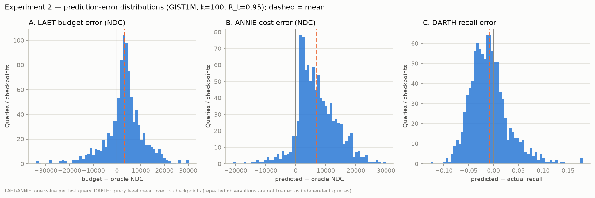
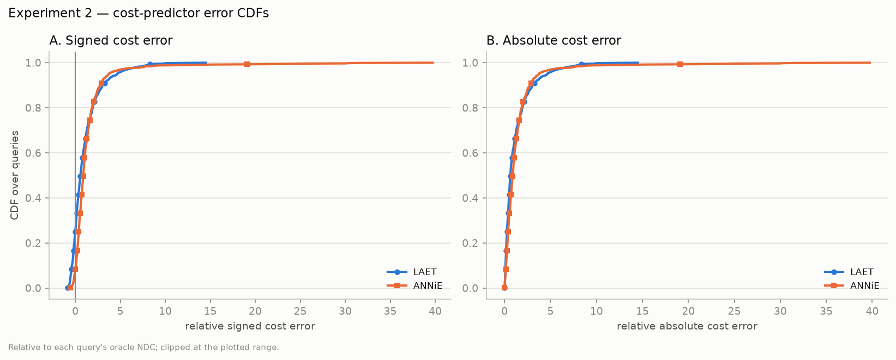
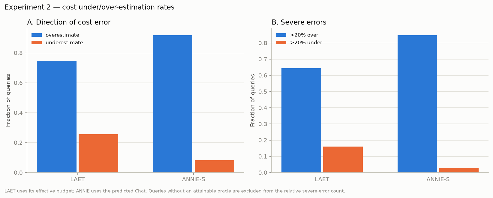
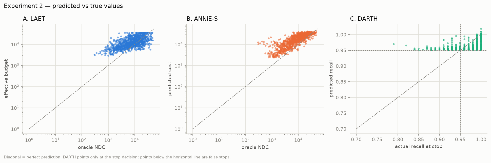
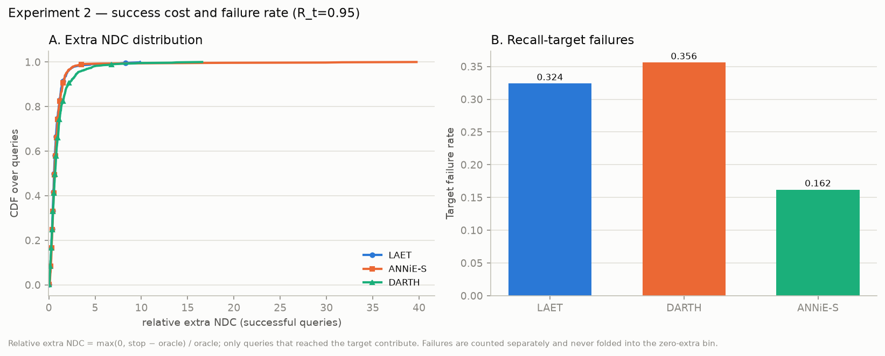
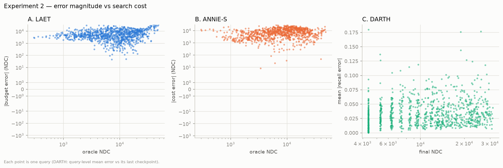
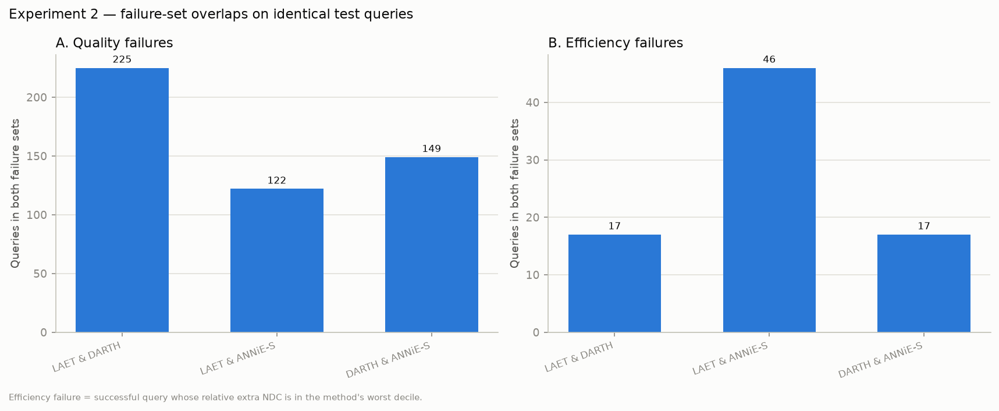
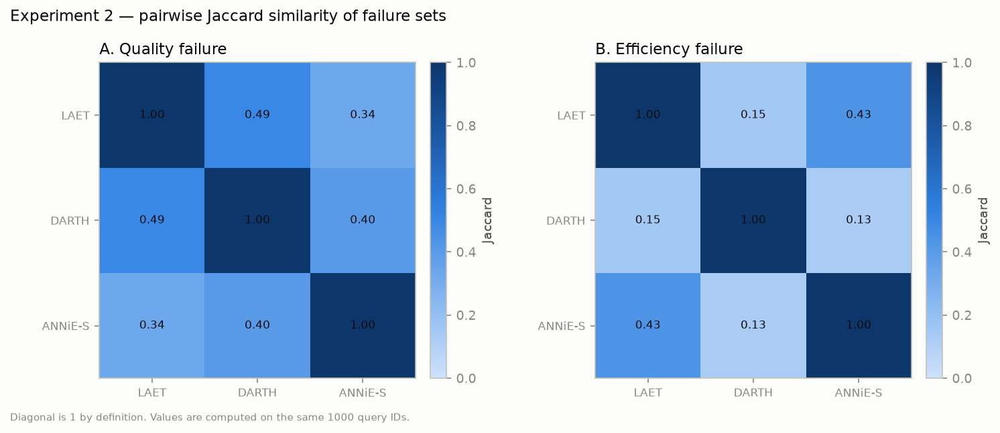

# Experiment 2 — Per-Query Error Analysis of Learned Early Termination

## 1. Introduction

Average NDC and average recall hide where the three methods fail.  This
experiment instruments every prediction on the same 1,000 official GIST1M
test queries (k=100, R_t=0.95, one graph) and asks four questions: what
errors each method makes, whether failures concentrate on the same queries,
how errors translate into stopping decisions, and whether training size /
distribution / target recall change the picture.

## 2. Research questions and hypotheses

RQ1/H1: the methods have different error distributions and tail risk.
RQ2/H2: severe failures may overlap across methods beyond query difficulty.
RQ3/H3: under- and over-estimation have asymmetric consequences.
RQ4/H4: training size, distribution and target recall affect the errors.

The null hypotheses and the stratified permutation design are in
`audit/method_audit.md` and the analysis code.

## 3. Methodology

* LAET: `log2(C1)` cost predictor, one call at f=1,260, multiplier
  calibrated on 500 validation queries; effective budget error is measured
  against the target-recall oracle.
* DARTH: current-recall predictor, adaptive interval
  `pi=mpi+(ipi-mpi)(R_t-pred)`; every checkpoint is logged.  Its bounded
  search uses ef=2048, the highest tested value, reaching validation mean
  recall@100 = 0.9855 (the 0.99 target is a recorded resource limitation).
* ANNiE-S: quantile (p=0.95) cost predictor at the homing transition;
  effective budget is `max(Chat, homing NDC)`.
* Oracles are computed on each method's own complete trajectory; `unknown`
  is kept distinct from `unreachable`.
* Training: 2,000 queries for the main fit; 500/1,000/2,000 nested
  subsets x 3 seeds for the size experiment.

## 4. Individual error analysis

| method | n | mean_recall | median_recall | hit_rate | failure_rate | avg_ndc | median_ndc | p95_ndc | p99_ndc | extra_ndc_mean | relative_extra_ndc | oracle_attainable_rate |
|---|---|---|---|---|---|---|---|---|---|---|---|---|
| LAET | 1000 | 0.9562 | 0.9700 | 0.6760 | 0.3240 | 12149.6441 | 10292.0000 | 28754.3500 | 34462.0100 | 4433.2738 | 0.7989 | 0.9800 |
| DARTH | 1000 | 0.9608 | 0.9700 | 0.6440 | 0.3560 | 12690.7180 | 10924.0000 | 27548.7000 | 30374.8800 | 4163.4193 | 1.0629 | 0.9260 |
| ANNiE-S | 1000 | 0.9736 | 0.9800 | 0.8380 | 0.1620 | 15996.1493 | 14109.0000 | 34560.1000 | 38417.8500 | 5967.1292 | 0.9350 | 0.9800 |

### Paired method comparison (same queries)

| diff | lo | hi | n | relative | A | B | metric | cliffs_delta |
|---|---|---|---|---|---|---|---|---|
| -0.0046 | -0.0070 | -0.0024 | 1000 | -0.0048 | LAET | DARTH | actual_recall | 0.0152 |
| -541.0739 | -922.6640 | -178.8256 | 1000 | -0.0426 | LAET | DARTH | stop_ndc | -0.0494 |
| -0.3338 | -0.4405 | -0.2303 | 545 | -0.2834 | LAET | DARTH | relative_extra_ndc | -0.1646 |
| -0.0175 | -0.0198 | -0.0152 | 1000 | -0.0180 | LAET | ANNiE-S | actual_recall | -0.1887 |
| -3846.5052 | -4287.0958 | -3413.7671 | 1000 | -0.2405 | LAET | ANNiE-S | stop_ndc | -0.1896 |
| -0.2310 | -0.4001 | -0.1106 | 636 | -0.2221 | LAET | ANNiE-S | relative_extra_ndc | -0.1125 |
| -0.0129 | -0.0143 | -0.0115 | 1000 | -0.0132 | DARTH | ANNiE-S | actual_recall | -0.2266 |
| -3305.4313 | -3648.4131 | -2963.2458 | 1000 | -0.2066 | DARTH | ANNiE-S | stop_ndc | -0.1486 |
| 0.0229 | -0.1194 | 0.1513 | 631 | 0.0217 | DARTH | ANNiE-S | relative_extra_ndc | -0.0039 |

## 5. Cross-method query analysis

| failure_type | A | B | intersection | union | jaccard | P_B_given_A | P_A_given_B | expected_independence | p_value | n_A | n_B |
|---|---|---|---|---|---|---|---|---|---|---|---|
| quality_fail | LAET | DARTH | 225 | 455.0000 | 0.4945 | 0.6944 | 0.6320 | 115.3440 | 0.0005 | 324 | 356 |
| quality_fail | LAET | ANNiE-S | 122 | 364.0000 | 0.3352 | 0.3765 | 0.7531 | 52.4880 | 0.0005 | 324 | 162 |
| quality_fail | DARTH | ANNiE-S | 149 | 369.0000 | 0.4038 | 0.4185 | 0.9198 | 57.6720 | 0.0005 | 356 | 162 |
| quality_fail | LAET∩DARTH∩ANNiE-S |  | 118 |  |  |  |  |  |  | 118 | 0 |

## 6. Training data analysis

### 6.1 Training-set size (mean over 3 seeds)

| train_size | seed | method | n | mean_recall | median_recall | hit_rate | failure_rate | avg_ndc | median_ndc | p95_ndc | p99_ndc | extra_ndc_mean | relative_extra_ndc | oracle_attainable_rate | multiplier | ipi | mpi |
|---|---|---|---|---|---|---|---|---|---|---|---|---|---|---|---|---|---|
| 500 | 42 | LAET | 1000 | 0.9557 | 0.9700 | 0.6510 | 0.3490 | 11878.6624 | 10600.5000 | 24895.0000 | 24904.0000 | 4258.9976 | 0.9250 | 0.9800 | 17.8784 |  |  |
| 500 | 42 | DARTH | 1000 | 0.9604 | 0.9700 | 0.6380 | 0.3620 | 12846.0150 | 11378.5000 | 26596.9500 | 30117.8100 | 4581.4013 | 1.2429 | 0.9260 |  | 4248.1866 | 849.6373 |
| 500 | 42 | ANNiE-S | 1000 | 0.9701 | 0.9800 | 0.7690 | 0.2310 | 14351.0519 | 13378.0000 | 30084.6500 | 33929.3800 | 5030.7437 | 1.0048 | 0.9800 |  |  |  |
| 500 | 43 | LAET | 1000 | 0.9557 | 0.9700 | 0.6510 | 0.3490 | 11878.6624 | 10600.5000 | 24895.0000 | 24904.0000 | 4258.9976 | 0.9250 | 0.9800 | 17.8784 |  |  |
| 500 | 43 | DARTH | 1000 | 0.9600 | 0.9700 | 0.6310 | 0.3690 | 12800.4310 | 11408.5000 | 26811.0500 | 29677.5100 | 4599.9620 | 1.2623 | 0.9260 |  | 4248.1866 | 849.6373 |
| 500 | 43 | ANNiE-S | 1000 | 0.9701 | 0.9800 | 0.7690 | 0.2310 | 14351.0519 | 13378.0000 | 30084.6500 | 33929.3800 | 5030.7437 | 1.0048 | 0.9800 |  |  |  |
| 500 | 44 | LAET | 1000 | 0.9557 | 0.9700 | 0.6510 | 0.3490 | 11878.6624 | 10600.5000 | 24895.0000 | 24904.0000 | 4258.9976 | 0.9250 | 0.9800 | 17.8784 |  |  |
| 500 | 44 | DARTH | 1000 | 0.9596 | 0.9700 | 0.6290 | 0.3710 | 12712.5710 | 11332.5000 | 26799.0500 | 29844.4200 | 4556.2003 | 1.3085 | 0.9260 |  | 4248.1866 | 849.6373 |
| 500 | 44 | ANNiE-S | 1000 | 0.9701 | 0.9800 | 0.7690 | 0.2310 | 14351.0519 | 13378.0000 | 30084.6500 | 33929.3800 | 5030.7437 | 1.0048 | 0.9800 |  |  |  |
| 1000 | 42 | LAET | 1000 | 0.9491 | 0.9700 | 0.5730 | 0.4270 | 11007.2218 | 9428.5000 | 26102.8500 | 34456.0100 | 3723.2230 | 0.8025 | 0.9800 | 16.0966 |  |  |
| 1000 | 42 | DARTH | 1000 | 0.9616 | 0.9700 | 0.6600 | 0.3400 | 13013.6320 | 10961.0000 | 27923.2000 | 31222.1600 | 4478.9152 | 1.1095 | 0.9260 |  | 4325.4376 | 865.0875 |
| 1000 | 42 | ANNiE-S | 1000 | 0.9726 | 0.9800 | 0.8080 | 0.1920 | 15080.4094 | 14111.0000 | 30628.8000 | 36575.5000 | 5354.4015 | 0.9958 | 0.9800 |  |  |  |
| 1000 | 43 | LAET | 1000 | 0.9491 | 0.9700 | 0.5730 | 0.4270 | 11007.2218 | 9428.5000 | 26102.8500 | 34456.0100 | 3723.2230 | 0.8025 | 0.9800 | 16.0966 |  |  |
| 1000 | 43 | DARTH | 1000 | 0.9616 | 0.9700 | 0.6600 | 0.3400 | 13043.0480 | 10902.5000 | 27902.3000 | 30850.9000 | 4546.7667 | 1.1196 | 0.9260 |  | 4325.4376 | 865.0875 |
| 1000 | 43 | ANNiE-S | 1000 | 0.9726 | 0.9800 | 0.8080 | 0.1920 | 15080.4094 | 14111.0000 | 30628.8000 | 36575.5000 | 5354.4015 | 0.9958 | 0.9800 |  |  |  |
| 1000 | 44 | LAET | 1000 | 0.9491 | 0.9700 | 0.5730 | 0.4270 | 11007.2218 | 9428.5000 | 26102.8500 | 34456.0100 | 3723.2230 | 0.8025 | 0.9800 | 16.0966 |  |  |
| 1000 | 44 | DARTH | 1000 | 0.9615 | 0.9700 | 0.6480 | 0.3520 | 13003.2750 | 11003.5000 | 27930.3000 | 30767.8300 | 4550.2346 | 1.1458 | 0.9260 |  | 4325.4376 | 865.0875 |
| 1000 | 44 | ANNiE-S | 1000 | 0.9726 | 0.9800 | 0.8080 | 0.1920 | 15080.4094 | 14111.0000 | 30628.8000 | 36575.5000 | 5354.4015 | 0.9958 | 0.9800 |  |  |  |
| 2000 | 42 | LAET | 1000 | 0.9562 | 0.9700 | 0.6760 | 0.3240 | 12149.6441 | 10292.0000 | 28754.3500 | 34462.0100 | 4433.2738 | 0.7989 | 0.9800 | 17.8784 |  |  |
| 2000 | 42 | DARTH | 1000 | 0.9608 | 0.9700 | 0.6440 | 0.3560 | 12690.7180 | 10924.0000 | 27548.7000 | 30374.8800 | 4163.4193 | 1.0629 | 0.9260 |  | 4383.1835 | 876.6367 |
| 2000 | 42 | ANNiE-S | 1000 | 0.9736 | 0.9800 | 0.8380 | 0.1620 | 15996.1493 | 14109.0000 | 34560.1000 | 38417.8500 | 5967.1292 | 0.9350 | 0.9800 |  |  |  |
| 2000 | 43 | LAET | 1000 | 0.9562 | 0.9700 | 0.6760 | 0.3240 | 12149.6441 | 10292.0000 | 28754.3500 | 34462.0100 | 4433.2738 | 0.7989 | 0.9800 | 17.8784 |  |  |
| 2000 | 43 | DARTH | 1000 | 0.9614 | 0.9700 | 0.6530 | 0.3470 | 12816.3110 | 10849.5000 | 27757.3000 | 30850.9000 | 4266.1562 | 1.0906 | 0.9260 |  | 4383.1835 | 876.6367 |
| 2000 | 43 | ANNiE-S | 1000 | 0.9736 | 0.9800 | 0.8380 | 0.1620 | 15996.1493 | 14109.0000 | 34560.1000 | 38417.8500 | 5967.1292 | 0.9350 | 0.9800 |  |  |  |
| 2000 | 44 | LAET | 1000 | 0.9562 | 0.9700 | 0.6760 | 0.3240 | 12149.6441 | 10292.0000 | 28754.3500 | 34462.0100 | 4433.2738 | 0.7989 | 0.9800 | 17.8784 |  |  |
| 2000 | 44 | DARTH | 1000 | 0.9614 | 0.9700 | 0.6630 | 0.3370 | 12822.0930 | 10920.5000 | 27424.1000 | 30807.3400 | 4233.2172 | 1.0780 | 0.9260 |  | 4383.1835 | 876.6367 |
| 2000 | 44 | ANNiE-S | 1000 | 0.9736 | 0.9800 | 0.8380 | 0.1620 | 15996.1493 | 14109.0000 | 34560.1000 | 38417.8500 | 5967.1292 | 0.9350 | 0.9800 |  |  |  |

### 6.2 Hard-query-enriched training (D2)

| condition | method | n | mean_recall | median_recall | hit_rate | failure_rate | avg_ndc | median_ndc | p95_ndc | p99_ndc | extra_ndc_mean | relative_extra_ndc | oracle_attainable_rate |
|---|---|---|---|---|---|---|---|---|---|---|---|---|---|
| D0_in_distribution | LAET | 1000 | 0.9467 | 0.9700 | 0.5960 | 0.4040 | 10880.5792 | 9509.0000 | 25379.0500 | 25391.0100 | 3910.2621 | 0.8436 | 0.9800 |
| D0_in_distribution | DARTH | 1000 | 0.9612 | 0.9700 | 0.6540 | 0.3460 | 12893.9780 | 11369.5000 | 26767.7000 | 30117.3100 | 4581.5076 | 1.1324 | 0.9260 |
| D0_in_distribution | ANNiE-S | 1000 | 0.9743 | 0.9800 | 0.8480 | 0.1520 | 15652.0615 | 14979.5000 | 31664.1000 | 35852.2400 | 5692.3449 | 1.1021 | 0.9800 |
| D2_hard_enriched | LAET | 1000 | 0.9528 | 0.9700 | 0.6240 | 0.3760 | 11849.7180 | 10125.5000 | 28996.7000 | 34460.0200 | 4433.5096 | 0.8680 | 0.9800 |
| D2_hard_enriched | DARTH | 1000 | 0.9669 | 0.9700 | 0.7240 | 0.2760 | 14324.1990 | 13536.5000 | 27465.2000 | 30052.6500 | 5614.7058 | 1.4316 | 0.9260 |
| D2_hard_enriched | ANNiE-S | 1000 | 0.9793 | 0.9900 | 0.9080 | 0.0920 | 18119.4309 | 18616.5000 | 34392.9000 | 37772.1800 | 7731.7212 | 1.4161 | 0.9800 |

## 7. Recall-target sensitivity

| target_recall | method | n | mean_recall | median_recall | hit_rate | failure_rate | avg_ndc | median_ndc | p95_ndc | p99_ndc | extra_ndc_mean | relative_extra_ndc | oracle_attainable_rate | multiplier | ipi | mpi | p |
|---|---|---|---|---|---|---|---|---|---|---|---|---|---|---|---|---|---|
| 0.9000 | LAET | 1000 | 0.9057 | 0.9300 | 0.6040 | 0.3960 | 7172.7420 | 5878.0000 | 16012.6000 | 23211.4300 | 2830.1772 | 0.8715 | 0.9960 | 9.5226 |  |  |  |
| 0.9000 | DARTH | 1000 | 0.9264 | 0.9300 | 0.7030 | 0.2970 | 8093.6290 | 7123.5000 | 17505.8000 | 23379.3300 | 2453.8734 | 0.8860 | 0.9870 |  | 3170.7554 | 634.1511 |  |
| 0.9000 | ANNiE-S | 1000 | 0.9454 | 0.9500 | 0.8540 | 0.1460 | 10124.7705 | 9256.5000 | 21375.6500 | 26498.8700 | 3888.6470 | 0.9809 | 0.9960 |  |  |  | 0.9500 |
| 0.9500 | LAET | 1000 | 0.9562 | 0.9700 | 0.6760 | 0.3240 | 12149.6441 | 10292.0000 | 28754.3500 | 34462.0100 | 4433.2738 | 0.7989 | 0.9800 | 17.8784 |  |  |  |
| 0.9500 | DARTH | 1000 | 0.9608 | 0.9700 | 0.6440 | 0.3560 | 12690.7180 | 10924.0000 | 27548.7000 | 30374.8800 | 4163.4193 | 1.0629 | 0.9260 |  | 4383.1835 | 876.6367 |  |
| 0.9500 | ANNiE-S | 1000 | 0.9736 | 0.9800 | 0.8380 | 0.1620 | 15996.1493 | 14109.0000 | 34560.1000 | 38417.8500 | 5967.1292 | 0.9350 | 0.9800 |  |  |  | 0.9500 |
| 0.9900 | LAET | 1000 | 0.9820 | 0.9900 | 0.6870 | 0.3130 | 20269.8550 | 20010.0000 | 34463.0000 | 34468.0000 | 387.4192 | 0.5097 | 0.7790 | 162.1207 |  |  |  |
| 0.9900 | DARTH | 1000 | 0.9806 | 0.9900 | 0.5840 | 0.4160 | 21446.2740 | 24344.0000 | 30743.2000 | 31833.1100 | 7588.2997 | 1.3693 | 0.6000 |  | 5370.4432 | 1074.0886 |  |
| 0.9900 | ANNiE-S | 1000 | 0.9833 | 0.9900 | 0.7030 | 0.2970 | 21406.8485 | 19609.5000 | 42778.9000 | 45047.8000 | 279.7632 | 0.4178 | 0.7790 |  |  |  | 0.9500 |

## 8. Hypothesis evaluation

* H1: compare the error distributions and tail metrics in §4.  Cost errors
  (LAET/ANNiE) and recall errors (DARTH) are reported on separate axes.
* H2: read the Jaccard, conditional failure probability and stratified
  permutation p-values in §5.  If the overlap disappears after conditioning
  on oracle-cost strata, the shared failure is query hardness, not a shared
  model defect.
* H3: compare false-positive stops / false-negative continues for DARTH and
  budget under-estimation for LAET/ANNiE with the target failure rates.  A
  positive signed error has opposite practical meaning for a cost predictor
  and a recall predictor.
* H4: compare the size, distribution and target-recall tables.  Three seeds
  are reported; a non-monotone or flat curve is evidence of no size effect,
  not proof of one.

**Explicit verdicts.**

| Hypothesis | Verdict | Evidence |
|---|---|---|
| H1 — different error distributions / tail risk | **Supported** | ANNiE hit 0.838 vs DARTH 0.644 / LAET 0.676; different error units and tails; see §4. |
| H2 — non-random failure overlap | **Supported, with caveat** | All pairwise quality-failure Jaccards 0.34-0.49, stratified permutation p=0.0005; 118 triple failures. Conditional probabilities differ, so shared difficulty does not imply a shared mechanism. |
| H3 — asymmetric consequences | **Supported** | Among failures, 77% of LAET have budget under-estimate, 85% of DARTH have recall over-estimate at stop; ANNiE is split (49% under). |
| H4 — size / distribution / target effects | **Partially supported** | ANNiE monotonically improves with n; DARTH is flat; LAET is non-monotone; hard-enriched training helps all but costs NDC; DARTH degrades at R_t=0.99. |

Conclusions are limited to what the CIs and permutation tests support; a
non-significant overlap is reported as “no evidence of extra association”,
not as independence.

## 9. Threats to validity

Python implementation; 992k index; 2,000 training queries; one dataset;
DARTH observations sampled every 25 NDC; ANNiE graph features use the
Def. 7 approximation; the efficiency-failure threshold is the method's own
worst decile, so cross-method efficiency sets are relative, not absolute.

## Figures

*Prediction-error distributions.*

*Signed and absolute error CDFs.*

*Over/under-estimation rates.*

*Predicted vs true values.*

*Extra NDC and target failures.*

*Error magnitude vs oracle cost.*

*Failure-set intersections.*

*Pairwise Jaccard similarity.*

