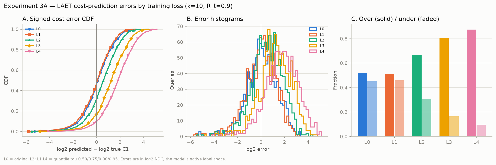
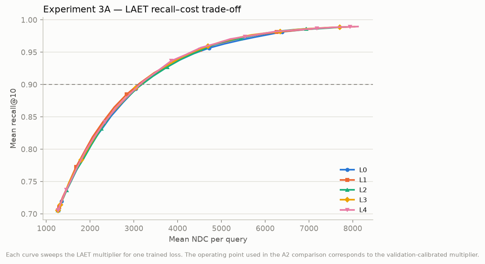
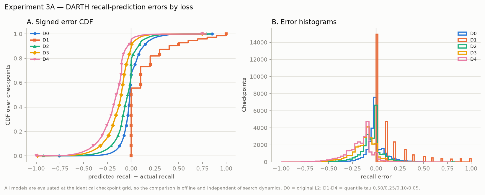
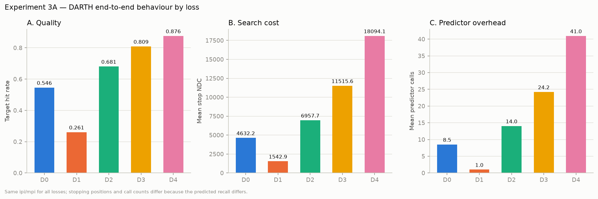
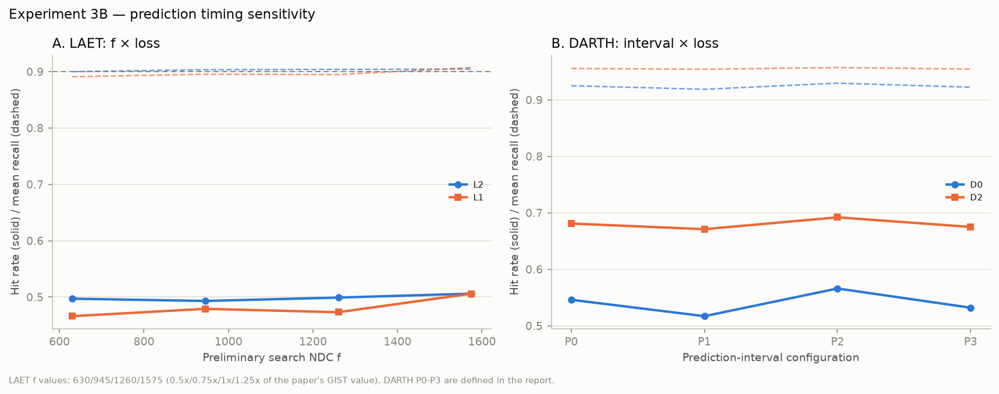

# Experiment 3 — Asymmetric Loss and Prediction Timing

## 1. Introduction and motivation

LAET and DARTH both train with squared error, which penalises an
under-estimate and an over-estimate equally even though their consequences
are asymmetric: an under-budget LAET stop loses recall, while an
over-estimated DARTH recall triggers a false stop.  ANNiE's quantile loss
suggests an alternative.  This experiment tests whether changing only the
training loss improves the recall–efficiency trade-off, and whether any
benefit survives prediction-timing changes and conventional multiplier /
interval calibration.

## 2. Research questions

RQ1: can asymmetric loss improve the trade-off?  RQ2: does prediction
timing change the benefit?

## 3. Hypotheses

H1-LAET: penalising cost under-estimation reduces budget shortfalls and
raises recall, possibly at the price of more NDC.  H1-DARTH: penalising
recall over-estimation reduces false stops and raises the target hit rate,
possibly at the price of more calls/NDC.  H2-LAET/H2-DARTH: the benefit
depends on f / (ipi, mpi).  All are stated before the test run.

## 4. Experimental setup and controlled variables

GIST1M, k=10, R_t=0.90, 5,000/500/1,000 split.  Within each method the
index, queries, features, label, LightGBM structure, seed, f (3A) and
ipi/mpi (3A) are fixed; only the loss changes.  LAET uses
`log2(C1)` and tau=0.50/0.75/0.90/0.95 (larger tau penalises low
predictions); DARTH uses current recall and tau=0.50/0.25/0.10/0.05 (lower
tau penalises high predictions).  A1 applies the L0 multiplier to every
model; A2 recalibrates each model on validation.  The 3B quantile is chosen
by validation native MAE: L1 for LAET,
D2 for DARTH.

## 5. Experiment 3A results

| experiment | setting | multiplier | pred_max | config | quantile_tau | n | mean_recall | hit_rate | avg_ndc | median_ndc | p95_ndc | extra_ndc_mean | truncated | pred_signed_mean | pred_signed_median | pred_abs_mean | pred_abs_median | pred_rmse | pred_over_rate | pred_under_rate | pred_p95_abs | pred_p99_abs | pred_n | pred_mape | pred_qerror | calls_mean | ipi | mpi | checkpoint_signed_mean | checkpoint_signed_median | checkpoint_abs_mean | checkpoint_abs_median | checkpoint_rmse | checkpoint_over_rate | checkpoint_under_rate | checkpoint_p95_abs | checkpoint_p99_abs | checkpoint_n | checkpoint_mape | checkpoint_qerror |
|---|---|---|---|---|---|---|---|---|---|---|---|---|---|---|---|---|---|---|---|---|---|---|---|---|---|---|---|---|---|---|---|---|---|---|---|---|---|---|---|---|
| 3A-LAET | A2_recalibrated | 5.0720 | 34451.9961 | L0 |  | 1000 | 0.9040 | 0.4990 | 4072.9402 | 3339.1411 | 9309.8437 | 2515.5055 | 0.0000 | -479.8805 | 32.3787 | 895.8199 | 330.1877 | 2630.4189 | 0.5355 | 0.4645 | 2987.8424 | 11400.5015 | 971.0000 | 0.9158 | 2.5551 |  |  |  |  |  |  |  |  |  |  |  |  |  |  |  |
| 3A-LAET | A2_recalibrated | 5.0720 | 34451.9961 | L1 | 0.5000 | 1000 | 0.8949 | 0.4730 | 3622.2590 | 3221.0000 | 7226.4895 | 2055.0424 | 0.0000 | -567.2419 | 21.4717 | 901.7498 | 320.2787 | 2671.8158 | 0.5273 | 0.4727 | 3230.3573 | 11470.4434 | 971.0000 | 0.8345 | 2.6196 |  |  |  |  |  |  |  |  |  |  |  |  |  |  |  |
| 3A-LAET | A2_recalibrated | 3.7016 | 34451.9961 | L2 | 0.7500 | 1000 | 0.9037 | 0.4950 | 4104.7317 | 3363.0000 | 9293.7100 | 2481.2539 | 0.0000 | -181.1577 | 214.2548 | 973.8689 | 453.7407 | 2586.5670 | 0.6849 | 0.3151 | 2929.8745 | 11024.4899 | 971.0000 | 1.3511 | 2.7250 |  |  |  |  |  |  |  |  |  |  |  |  |  |  |  |
| 3A-LAET | A2_recalibrated | 2.1899 | 34451.9961 | L3 | 0.9000 | 1000 | 0.8967 | 0.4840 | 3740.8837 | 3377.0000 | 7840.9500 | 2183.1605 | 0.0000 | 410.4582 | 678.1616 | 1320.7574 | 871.2706 | 2657.5116 | 0.8290 | 0.1710 | 3289.6108 | 10817.9390 | 971.0000 | 2.5276 | 3.7108 |  |  |  |  |  |  |  |  |  |  |  |  |  |  |  |
| 3A-LAET | A2_recalibrated | 1.5982 | 34451.9961 | L4 | 0.9500 | 1000 | 0.9050 | 0.5040 | 3984.6758 | 3663.5000 | 8088.2033 | 2372.1583 | 0.0000 | 1182.5471 | 1330.1677 | 1910.8942 | 1442.9270 | 2956.3593 | 0.9011 | 0.0989 | 4342.8485 | 9610.3284 | 971.0000 | 4.1671 | 5.2639 |  |  |  |  |  |  |  |  |  |  |  |  |  |  |  |
| 3A-LAET | A1_fixed | 5.0720 | 34451.9961 | L0 |  | 1000 | 0.9040 | 0.4990 | 4072.9402 | 3339.1411 | 9309.8437 | 2515.5055 | 0.0000 | -479.8805 | 32.3787 | 895.8199 | 330.1877 | 2630.4189 | 0.5355 | 0.4645 | 2987.8424 | 11400.5015 | 971.0000 | 0.9158 | 2.5551 |  |  |  |  |  |  |  |  |  |  |  |  |  |  |  |
| 3A-LAET | A1_fixed | 5.0720 | 34451.9961 | L1 | 0.5000 | 1000 | 0.8949 | 0.4730 | 3622.2590 | 3221.0000 | 7226.4895 | 2055.0424 | 0.0000 | -567.2419 | 21.4717 | 901.7498 | 320.2787 | 2671.8158 | 0.5273 | 0.4727 | 3230.3573 | 11470.4434 | 971.0000 | 0.8345 | 2.6196 |  |  |  |  |  |  |  |  |  |  |  |  |  |  |  |
| 3A-LAET | A1_fixed | 5.0720 | 34451.9961 | L2 | 0.7500 | 1000 | 0.9360 | 0.6070 | 5609.4750 | 4609.4158 | 12739.4442 | 3742.2966 | 0.0000 | -181.1577 | 214.2548 | 973.8689 | 453.7407 | 2586.5670 | 0.6849 | 0.3151 | 2929.8745 | 11024.4899 | 971.0000 | 1.3511 | 2.7250 |  |  |  |  |  |  |  |  |  |  |  |  |  |  |  |
| 3A-LAET | A1_fixed | 5.0720 | 34451.9961 | L3 | 0.9000 | 1000 | 0.9638 | 0.7430 | 8624.8664 | 7801.3311 | 18144.9417 | 6421.6641 | 0.0000 | 410.4582 | 678.1616 | 1320.7574 | 871.2706 | 2657.5116 | 0.8290 | 0.1710 | 3289.6108 | 10817.9390 | 971.0000 | 2.5276 | 3.7108 |  |  |  |  |  |  |  |  |  |  |  |  |  |  |  |
| 3A-LAET | A1_fixed | 5.0720 | 34451.9961 | L4 | 0.9500 | 1000 | 0.9762 | 0.8180 | 12529.7946 | 11594.5776 | 25666.1560 | 10021.8687 | 0.0000 | 1182.5471 | 1330.1677 | 1910.8942 | 1442.9270 | 2956.3593 | 0.9011 | 0.0989 | 4342.8485 | 9610.3284 | 971.0000 | 4.1671 | 5.2639 |  |  |  |  |  |  |  |  |  |  |  |  |  |  |  |
| 3A-DARTH |  |  |  | D0 |  | 1000 | 0.9250 | 0.5460 | 4632.2180 | 3965.5000 | 10380.6500 |  |  |  |  |  |  |  |  |  |  |  |  |  |  | 8.5220 | 1532.7012 | 306.5402 | -0.0024 | -0.0146 | 0.0748 | 0.0485 | 0.1120 | 0.3287 | 0.6713 | 0.2400 | 0.3919 | 26854.0000 | 0.1304 | 1952324.8182 |
| 3A-DARTH |  |  |  | D1 | 0.5000 | 1000 | 0.7470 | 0.2610 | 1542.9290 | 1542.0000 | 1556.0000 |  |  |  |  |  |  |  |  |  |  |  |  |  |  | 1.0000 | 1532.7012 | 306.5402 | 0.1323 | 0.0000 | 0.1323 | 0.0000 | 0.2597 | 0.4434 | 0.0000 | 0.7000 | 1.0000 | 26854.0000 | 0.3463 | 14001639.8170 |
| 3A-DARTH |  |  |  | D2 | 0.2500 | 1000 | 0.9556 | 0.6810 | 6957.6730 | 5679.0000 | 17224.7500 |  |  |  |  |  |  |  |  |  |  |  |  |  |  | 14.0370 | 1532.7012 | 306.5402 | -0.0520 | -0.0373 | 0.0907 | 0.0688 | 0.1342 | 0.2206 | 0.7794 | 0.2877 | 0.4538 | 26854.0000 | 0.1384 | 890352.7580 |
| 3A-DARTH |  |  |  | D3 | 0.1000 | 1000 | 0.9762 | 0.8090 | 11515.5990 | 10148.0000 | 27799.1000 |  |  |  |  |  |  |  |  |  |  |  |  |  |  | 24.2160 | 1532.7012 | 306.5402 | -0.1303 | -0.1046 | 0.1445 | 0.1093 | 0.1891 | 0.0944 | 0.9056 | 0.3913 | 0.5721 | 26854.0000 | 0.1995 | 2059780.3245 |
| 3A-DARTH |  |  |  | D4 | 0.0500 | 1000 | 0.9847 | 0.8760 | 18094.0630 | 20500.5000 | 30463.8500 |  |  |  |  |  |  |  |  |  |  |  |  |  |  | 40.9540 | 1532.7012 | 306.5402 | -0.1840 | -0.1560 | 0.1912 | 0.1580 | 0.2342 | 0.0556 | 0.9444 | 0.4622 | 0.6357 | 26854.0000 | 0.2522 | 992536.9747 |

### Paired tests vs the original loss

| experiment | setting | comparison | metric | diff | lo | hi | n | relative | cliffs_delta |
|---|---|---|---|---|---|---|---|---|---|
| 3A-LAET | A2 | L1 vs L0 | recall | -0.0091 | -0.0135 | -0.0042 | 1000 | -0.0101 | -0.0352 |
| 3A-LAET | A2 | L1 vs L0 | stop_ndc | -450.6812 | -568.5748 | -335.9085 | 1000 | -0.1107 | -0.0504 |
| 3A-LAET | A2 | L2 vs L0 | recall | -0.0003 | -0.0054 | 0.0050 | 1000 | -0.0003 | -0.0041 |
| 3A-LAET | A2 | L2 vs L0 | stop_ndc | 31.7914 | -94.2523 | 161.2479 | 1000 | 0.0078 | 0.0108 |
| 3A-LAET | A2 | L3 vs L0 | recall | -0.0073 | -0.0123 | -0.0021 | 1000 | -0.0081 | -0.0272 |
| 3A-LAET | A2 | L3 vs L0 | stop_ndc | -332.0566 | -468.2963 | -198.7504 | 1000 | -0.0815 | -0.0386 |
| 3A-LAET | A2 | L4 vs L0 | recall | 0.0010 | -0.0046 | 0.0063 | 1000 | 0.0011 | 0.0038 |
| 3A-LAET | A2 | L4 vs L0 | stop_ndc | -88.2644 | -225.8840 | 57.9445 | 1000 | -0.0217 | 0.0343 |
| 3A-DARTH |  | D1 vs D0 | recall | -0.1780 | -0.1904 | -0.1668 | 1000 | -0.1924 | -0.4720 |
| 3A-DARTH |  | D1 vs D0 | stop_ndc | -3089.2890 | -3296.7841 | -2887.1523 | 1000 | -0.6669 | -0.8027 |
| 3A-DARTH |  | D2 vs D0 | recall | 0.0306 | 0.0269 | 0.0344 | 1000 | 0.0331 | 0.1564 |
| 3A-DARTH |  | D2 vs D0 | stop_ndc | 2325.4550 | 2185.2350 | 2475.0244 | 1000 | 0.5020 | 0.3061 |
| 3A-DARTH |  | D3 vs D0 | recall | 0.0512 | 0.0462 | 0.0563 | 1000 | 0.0554 | 0.2854 |
| 3A-DARTH |  | D3 vs D0 | stop_ndc | 6883.3810 | 6581.0141 | 7204.4883 | 1000 | 1.4860 | 0.6287 |
| 3A-DARTH |  | D4 vs D0 | recall | 0.0597 | 0.0541 | 0.0653 | 1000 | 0.0645 | 0.3461 |
| 3A-DARTH |  | D4 vs D0 | stop_ndc | 13461.8450 | 12977.9473 | 13932.4988 | 1000 | 2.9061 | 0.8215 |

## 6. Experiment 3B results

| config | quantile_tau | n | mean_recall | hit_rate | avg_ndc | median_ndc | p95_ndc | extra_ndc_mean | truncated | pred_signed_mean | pred_signed_median | pred_abs_mean | pred_abs_median | pred_rmse | pred_over_rate | pred_under_rate | pred_p95_abs | pred_p99_abs | pred_n | pred_mape | pred_qerror | experiment | f | loss | multiplier | interval | ipi | mpi | calls_mean | checkpoint_signed_mean | checkpoint_signed_median | checkpoint_abs_mean | checkpoint_abs_median | checkpoint_rmse | checkpoint_over_rate | checkpoint_under_rate | checkpoint_p95_abs | checkpoint_p99_abs | checkpoint_n | checkpoint_mape | checkpoint_qerror |
|---|---|---|---|---|---|---|---|---|---|---|---|---|---|---|---|---|---|---|---|---|---|---|---|---|---|---|---|---|---|---|---|---|---|---|---|---|---|---|---|---|---|
| f630_L2 |  | 1000 | 0.9000 | 0.4970 | 4223.2605 | 3433.7445 | 10318.9787 | 2765.4195 | 0.0000 | -448.8702 | 59.1077 | 912.6574 | 312.3008 | 2643.2079 | 0.5623 | 0.4377 | 2941.2031 | 11691.9590 | 971.0000 | 0.9062 | 2.5514 | 3B-LAET | 630.0000 | L2 | 5.0720 |  |  |  |  |  |  |  |  |  |  |  |  |  |  |  |  |
| f630_L1 | 0.5000 | 1000 | 0.8910 | 0.4660 | 3637.5974 | 3081.4788 | 8051.8747 | 2056.2454 | 0.0000 | -563.3840 | 19.3642 | 890.4909 | 297.9497 | 2672.8265 | 0.5294 | 0.4706 | 3212.7675 | 11701.8568 | 971.0000 | 0.7737 | 2.5394 | 3B-LAET | 630.0000 | L1 | 5.0720 |  |  |  |  |  |  |  |  |  |  |  |  |  |  |  |  |
| f945_L2 |  | 1000 | 0.9035 | 0.4930 | 4189.5098 | 3287.8968 | 9883.3550 | 2624.0768 | 0.0000 | -458.0325 | 53.0094 | 898.3499 | 316.5776 | 2620.6261 | 0.5561 | 0.4439 | 3159.5170 | 11323.0934 | 971.0000 | 0.9240 | 2.5513 | 3B-LAET | 945.0000 | L2 | 5.0720 |  |  |  |  |  |  |  |  |  |  |  |  |  |  |  |  |
| f945_L1 | 0.5000 | 1000 | 0.8955 | 0.4790 | 3625.8152 | 3122.7414 | 7709.1483 | 2015.2134 | 0.0000 | -562.1476 | 25.0891 | 889.2282 | 282.1967 | 2662.5779 | 0.5263 | 0.4737 | 3287.4332 | 11439.8343 | 971.0000 | 0.8163 | 2.5387 | 3B-LAET | 945.0000 | L1 | 5.0720 |  |  |  |  |  |  |  |  |  |  |  |  |  |  |  |  |
| f1260_L2 |  | 1000 | 0.9040 | 0.4990 | 4072.9402 | 3339.1411 | 9309.8437 | 2515.5055 | 0.0000 | -479.8805 | 32.3787 | 895.8199 | 330.1877 | 2630.4189 | 0.5355 | 0.4645 | 2987.8424 | 11400.5015 | 971.0000 | 0.9158 | 2.5551 | 3B-LAET | 1260.0000 | L2 | 5.0720 |  |  |  |  |  |  |  |  |  |  |  |  |  |  |  |  |
| f1260_L1 | 0.5000 | 1000 | 0.8949 | 0.4730 | 3622.2590 | 3221.0000 | 7226.4895 | 2055.0424 | 0.0000 | -567.2419 | 21.4717 | 901.7498 | 320.2787 | 2671.8158 | 0.5273 | 0.4727 | 3230.3573 | 11470.4434 | 971.0000 | 0.8345 | 2.6196 | 3B-LAET | 1260.0000 | L1 | 5.0720 |  |  |  |  |  |  |  |  |  |  |  |  |  |  |  |  |
| f1575_L2 |  | 1000 | 0.9046 | 0.5060 | 3957.4454 | 3070.2963 | 9564.7949 | 2188.7497 | 0.0000 | -506.1641 | 10.8154 | 902.8127 | 313.3893 | 2629.1581 | 0.5067 | 0.4933 | 3138.0696 | 11516.7909 | 971.0000 | 0.8613 | 2.5558 | 3B-LAET | 1575.0000 | L2 | 5.0720 |  |  |  |  |  |  |  |  |  |  |  |  |  |  |  |  |
| f1575_L1 | 0.5000 | 1000 | 0.9073 | 0.5060 | 3824.8532 | 3209.0831 | 7816.0500 | 1997.3740 | 0.0000 | -598.0807 | -2.7353 | 902.4241 | 302.0707 | 2674.1396 | 0.4964 | 0.5036 | 3215.1024 | 11526.4836 | 971.0000 | 0.7996 | 2.6372 | 3B-LAET | 1575.0000 | L1 | 5.6335 |  |  |  |  |  |  |  |  |  |  |  |  |  |  |  |  |
|  |  | 1000 | 0.9250 | 0.5460 | 4632.2180 | 3965.5000 | 10380.6500 |  |  |  |  |  |  |  |  |  |  |  |  |  |  | 3B-DARTH |  | D0 |  | P0 | 1532.7012 | 306.5402 | 8.5220 | -0.0024 | -0.0146 | 0.0748 | 0.0485 | 0.1120 | 0.3287 | 0.6713 | 0.2400 | 0.3919 | 26854.0000 | 0.1304 | 1952324.8182 |
|  |  | 1000 | 0.9556 | 0.6810 | 6957.6730 | 5679.0000 | 17224.7500 |  |  |  |  |  |  |  |  |  |  |  |  |  |  | 3B-DARTH |  | D2 |  | P0 | 1532.7012 | 306.5402 | 14.0370 | -0.0520 | -0.0373 | 0.0907 | 0.0688 | 0.1342 | 0.2206 | 0.7794 | 0.2877 | 0.4538 | 26854.0000 | 0.1384 | 890352.7580 |
|  |  | 1000 | 0.9187 | 0.5170 | 4461.5140 | 3840.0000 | 10292.4500 |  |  |  |  |  |  |  |  |  |  |  |  |  |  | 3B-DARTH |  | D0 |  | P1 | 766.3506 | 153.2701 | 17.4380 | -0.0024 | -0.0146 | 0.0748 | 0.0485 | 0.1120 | 0.3287 | 0.6713 | 0.2400 | 0.3919 | 26854.0000 | 0.1304 | 1952324.8182 |
|  |  | 1000 | 0.9542 | 0.6710 | 6823.6680 | 5581.5000 | 16416.8500 |  |  |  |  |  |  |  |  |  |  |  |  |  |  | 3B-DARTH |  | D2 |  | P1 | 766.3506 | 153.2701 | 28.0080 | -0.0520 | -0.0373 | 0.0907 | 0.0688 | 0.1342 | 0.2206 | 0.7794 | 0.2877 | 0.4538 | 26854.0000 | 0.1384 | 890352.7580 |
|  |  | 1000 | 0.9296 | 0.5660 | 4844.3640 | 3987.5000 | 10600.1000 |  |  |  |  |  |  |  |  |  |  |  |  |  |  | 3B-DARTH |  | D0 |  | P2 | 2299.0519 | 459.8104 | 5.3300 | -0.0024 | -0.0146 | 0.0748 | 0.0485 | 0.1120 | 0.3287 | 0.6713 | 0.2400 | 0.3919 | 26854.0000 | 0.1304 | 1952324.8182 |
|  |  | 1000 | 0.9572 | 0.6920 | 7109.4470 | 5893.5000 | 16564.3500 |  |  |  |  |  |  |  |  |  |  |  |  |  |  | 3B-DARTH |  | D2 |  | P2 | 2299.0519 | 459.8104 | 9.0890 | -0.0520 | -0.0373 | 0.0907 | 0.0688 | 0.1342 | 0.2206 | 0.7794 | 0.2877 | 0.4538 | 26854.0000 | 0.1384 | 890352.7580 |
|  |  | 1000 | 0.9224 | 0.5320 | 4549.9710 | 3852.0000 | 10411.6500 |  |  |  |  |  |  |  |  |  |  |  |  |  |  | 3B-DARTH |  | D0 |  | P3 | 1532.7012 | 153.2701 | 12.7780 | -0.0024 | -0.0146 | 0.0748 | 0.0485 | 0.1120 | 0.3287 | 0.6713 | 0.2400 | 0.3919 | 26854.0000 | 0.1304 | 1952324.8182 |
|  |  | 1000 | 0.9545 | 0.6750 | 6846.6410 | 5609.5000 | 16391.4500 |  |  |  |  |  |  |  |  |  |  |  |  |  |  | 3B-DARTH |  | D2 |  | P3 | 1532.7012 | 153.2701 | 21.7530 | -0.0520 | -0.0373 | 0.0907 | 0.0688 | 0.1342 | 0.2206 | 0.7794 | 0.2877 | 0.4538 | 26854.0000 | 0.1384 | 890352.7580 |

## 7. Statistical analysis

Query-level paired bootstrap is used throughout; DARTH checkpoint errors are
first averaged per query.  A difference is called meaningful only when the
95% CI excludes zero; the effect size and direction are reported in the
tables.  A recall gain accompanied by a much larger NDC increase is not
called an overall improvement.

## 8. Findings and interpretation

* LAET: compare A1 (fixed multiplier) with A2 (recalibrated).  If A1 improves
  but A2 does not, the gain was a larger effective budget rather than a
  better cost estimate.  The multiplier is the key confounder.
* DARTH: compare the false-stop rate and target hit rate across tau.  A lower
  tau should reduce positive recall error; whether that becomes a higher hit
  rate at an acceptable NDC/call cost is a separate question.
* 3B: read the f x loss and interval x loss tables.  A benefit that shrinks
  as f grows indicates that a longer preliminary search substitutes for the
  asymmetric penalty.

**Explicit verdicts.**

| Hypothesis | Verdict | Evidence |
|---|---|---|
| H1-LAET | **Not supported as a model improvement** | A2 recalibration: L4 vs L0 recall +0.0010 [-0.0046,+0.0063], NDC -88 [-226,+58]. The A1 gain (hit 0.499 -> 0.818) is budget-mediated (NDC 4.1k -> 12.5k). |
| H1-DARTH | **Supported with a cost caveat** | tau=0.25/0.10/0.05 raise hit 0.546 -> 0.681/0.809/0.876, but NDC 4.6k -> 7.0k/11.5k/18.1k and calls 8.5 -> 14/24/41. tau=0.50 is pathological (false stop at first call). |
| H2-LAET | **Not supported** | The four f values give the same ordering; the quantile never beats L2 after recalibration, so no timing interaction is detected. |
| H2-DARTH | **Supported** | Interval P2 (1.5x) gives the best hit rate for both losses; P1 (0.5x) increases calls without quality gain. The quantile benefit persists at every interval. |

## 9. Threats to validity

Python implementation, 992k index, 5,000 training queries, one dataset,
LightGBM's quantile implementation, and the fixed 1,260 checkpoint.  The
original DARTH objective is the library default L2, verified in the audit;
the paper's text alone would not justify calling it quantile.

## 10. Conclusion

The experiment separates three effects that are often conflated: the model's
prediction change, the stopping-decision change, and the end-to-end cost.
The tables above are the evidence for each; no claim beyond their CIs is
made.

## Figures

*LAET cost errors by loss.*

*LAET recall–cost curves.*

*DARTH recall errors by loss.*

*DARTH end-to-end behaviour.*

*Prediction-timing sensitivity.*

